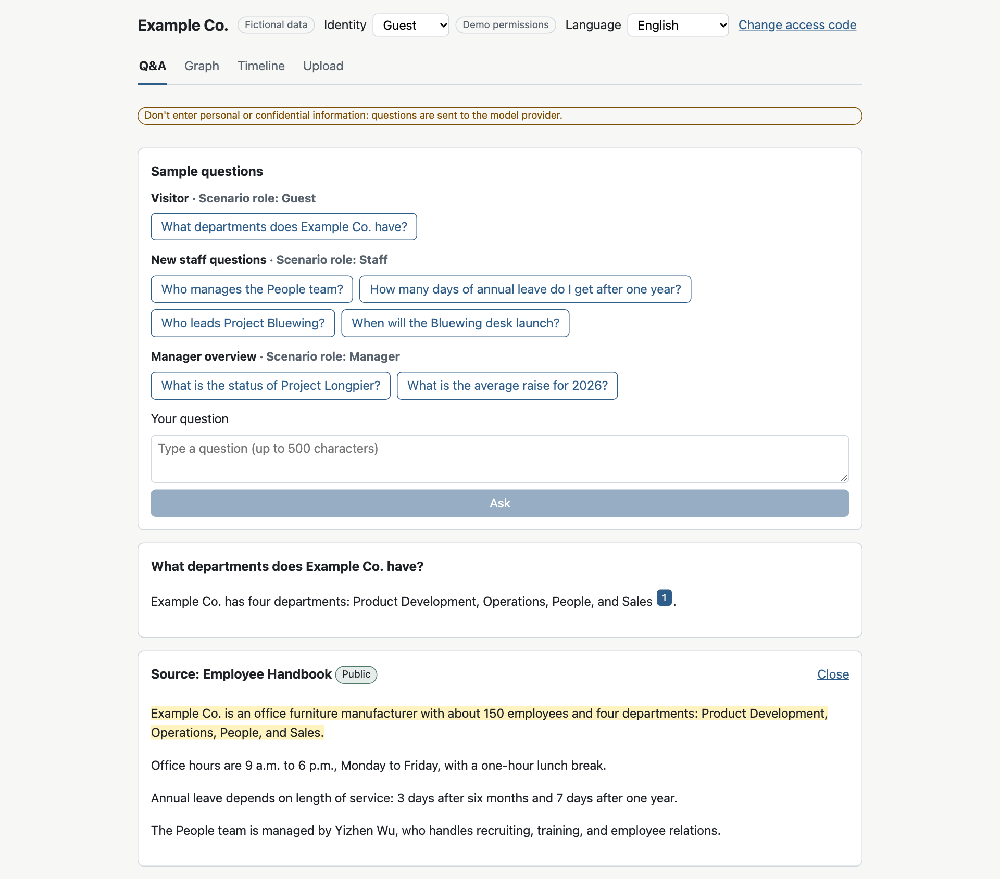
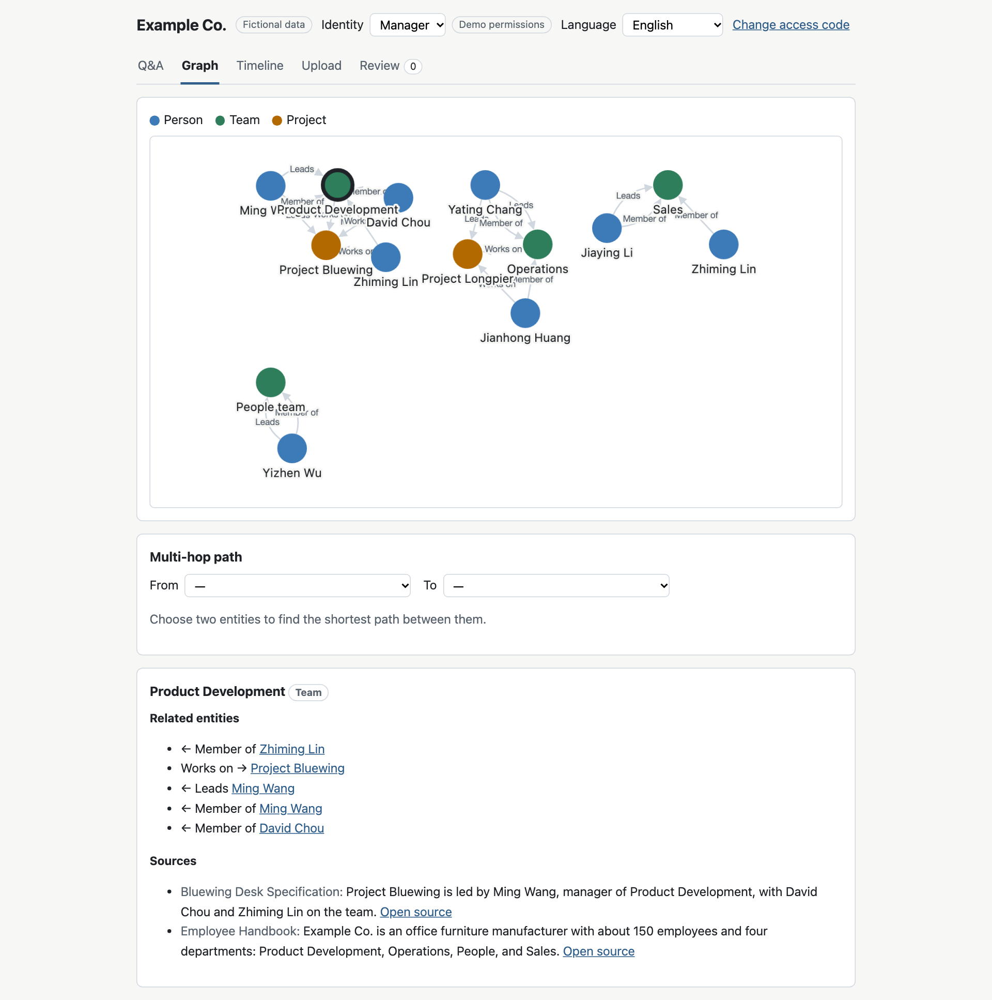
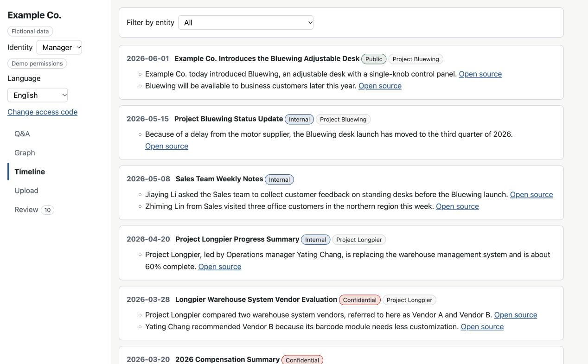
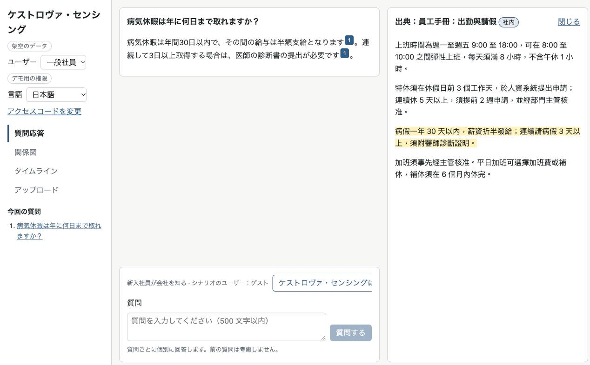

# knowledge-kit

English | [繁體中文](README.zh-TW.md)

A template for quickly building a "second brain" knowledge platform demo for an organization, using fictional data. To switch to another organization, you change only its settings (`client/` or `clients/<name>/`), not the code.

**Online demo:** <https://knowledge-kit-demo.bentsai0212.workers.dev> (see [Online demo](#online-demo))

The demo is a prototype for demonstration, not a production system.

## Features

- **Q&A with citations and refusals**: answers cite the passages they are based on, and the app refuses when the visible documents don't contain the answer ([docs/qa.md](docs/qa.md)).
- **Visibility levels and project permissions**: each role sees only the documents allowed by its level and projects, enforced by row-level security in PGlite ([docs/data-model.md](docs/data-model.md)).
- **Knowledge graph and paths**: entities and relations from the documents, and the shortest path between two entities ([docs/graph.md](docs/graph.md)).
- **Timeline**: visible documents and passages by date ([docs/graph.md](docs/graph.md)).
- **Upload and extraction**: uploaded documents are split into passages, and extracted entities and relations are written only after review ([docs/upload.md](docs/upload.md), [docs/extraction.md](docs/extraction.md)).
- **Conflicting information**: detects when an uploaded document says something different from existing passages ([docs/conflicts.md](docs/conflicts.md)).
- **Evaluation page**: runs a question bank and scores citations, key points, refusals, and leaks ([docs/evals.md](docs/evals.md)).
- **Multilingual interface and retrieval**: interface text comes from translation files, and retrieval handles each language's script ([docs/client-config.md](docs/client-config.md), [docs/retrieval.md](docs/retrieval.md)). Optionally, in-browser semantic vectors (`multilingual-e5-small`) enable cross-language retrieval: ask in one language and retrieve documents written in another ([docs/retrieval.md](docs/retrieval.md#語意向量multilingual-e5-small), section "語意向量").
- **Theme colors and dark mode**: colors come from the settings, with a dark palette for `prefers-color-scheme: dark` ([docs/client-config.md](docs/client-config.md)).

An answer to a preset question, with its citation and the source passage opened:



The knowledge graph with an entity panel, seen as a manager:



The first screen of the timeline, seen as a manager:



Cross-language retrieval in the fictional multilingual client `clients/kestrova-demo/`, seen as an employee: a question asked in Japanese is answered in Japanese, citing an employee handbook passage written in Traditional Chinese:



## Online demo

**Try it:** <https://knowledge-kit-demo.bentsai0212.workers.dev>

- A public trial code is already filled in; just submit it. All visitors share its daily question limit, so the quota may run out for the day.
- The evaluation page is hidden, because one run makes many model calls.
- Questions and uploaded content are sent to the model provider. **Don't enter or upload personal or confidential information.**
- Uploaded documents exist only in your browser and disappear when you reload the page.
- **Presentation mode**: add `?mode=presentation` to the URL to show only Q&A and the graph, which suits showing the demo to others ([docs/qa.md](docs/qa.md#展示模式)).
- The online demo uses the reference scenario with `keyword-hash` retrieval and downloads no model. To try cross-language retrieval, run `clients/kestrova-demo/` locally with `KK_CLIENT=kestrova-demo` ([clients/README.md](clients/README.md)).
- To request your own access code, open an Issue in this repo with the "Access code request" template. The code is never posted in the public Issue.

## Quick start

You need Node 22 or later.

```bash
npm install
npm run dev
```

This starts the reference scenario (`client/`) with the Vite dev server. Browsing the graph, timeline, and documents works without a key. To ask questions, run the Worker locally with your own Anthropic API key:

```bash
cp .dev.vars.example .dev.vars
npm run build
npx wrangler dev
```

Fill in `ANTHROPIC_API_KEY` and your own `ACCESS_CODES` in `.dev.vars` before running `npx wrangler dev`. `.dev.vars` is not committed. Details, including using `npm run dev` together with the Worker, are in [worker/README.md](worker/README.md).

Other commands (type check, tests, client settings check, Playwright) are listed in [AGENTS.md](AGENTS.md) section 2.

## Make it your own

- **After forking**: change the accounts and settings listed in [docs/workflow/fork.md](docs/workflow/fork.md).
- **A new organization**: follow the playbook ([English](docs/playbook/en/README.md), [繁體中文](docs/playbook/README.md)) for the interview, data inventory, data security, question bank, and setup steps. The settings are described in [docs/client-config.md](docs/client-config.md), and each organization goes in its own folder ([clients/README.md](clients/README.md)).
- **Deploying an online demo**: [docs/deploy.md](docs/deploy.md).

## Architecture

```text
Browser                                   Cloudflare Worker
+-------------------------------+         +------------------------------+
| Vite + React + TypeScript     |  POST   | /api/ask                     |
| PGlite (Postgres in browser)  | ------> |  access code, daily limits,  | ---> Claude Messages API
|  documents, RLS, graph,       |  SSE    |  same-site check,            |
|  retrieval, review queue      | <------ |  model allowlist             |
+-------------------------------+         | static files from dist/      |
                                          +------------------------------+
```

| Part | Contents |
| --- | --- |
| `app/` | Front end: Vite, React, and TypeScript. All data lives in an in-memory PGlite database in the browser, rebuilt from the migrations and the dataset on load. |
| `worker/` | Cloudflare Worker: forwards `/api/ask` to the Claude Messages API and serves `dist/`. Checks the access code, daily limits, and origin ([worker/README.md](worker/README.md)). |
| `client/` | Settings, translation files, fictional dataset, and question bank of the reference scenario. |
| `clients/` | One folder per organization, with the same structure as `client/`. |

Technology choices are recorded in [ADR 0001](docs/adr/0001-tech-stack.md), and the other decisions in [docs/adr/README.md](docs/adr/README.md).

## How this repo is developed

This repo is developed by coding agents working from GitHub Issues, and the workflow is published along with the code:

- [AGENTS.md](AGENTS.md): rules and commands for coding agents.
- [docs/workflow/](docs/workflow/): the constitution and workflow handbook.
- [tools/workflow/runner/](tools/workflow/runner/README.md): a runner that picks Issues and hands them to an agent.

You are welcome to use them as a reference. They are written for this repo, so after forking, adjust them as described in [docs/workflow/fork.md](docs/workflow/fork.md).

## Documentation language

Most documents in `docs/`, as well as `AGENTS.md` and the code comments, are in Traditional Chinese. The playbook has an English version in [docs/playbook/en/](docs/playbook/en/README.md), and this README and [SECURITY.md](SECURITY.md) are in English.

## Data and security

- All data in this repo and in the online demo is fictional.
- The permissions are for demonstration: all data is in the browser, so they are not real access control. See [data security](docs/playbook/en/data-security.md).
- The API key is stored only as a Worker secret, never in the repo or the browser.
- To report a vulnerability, see [SECURITY.md](SECURITY.md).

## Status and roadmap

- **v1**: the features above (phase 1 of [RFC 0001](docs/rfcs/0001-project-charter.md)) and the online demo. See [CHANGELOG.md](CHANGELOG.md).
- **v2**: cross-language retrieval with optional in-browser semantic vectors (`multilingual-e5-small`), tested with the fictional multilingual client `clients/kestrova-demo/` (Traditional Chinese, English, and Japanese, each fact written in only one language). Its 18 cross-language questions across six directions scored 18/18 for both citations and answers ([evaluation results](clients/kestrova-demo/evals/README.md#驗收結果), [RFC 0002](docs/rfcs/0002-public-release.md)). See [CHANGELOG.md](CHANGELOG.md).

## License

[MIT](LICENSE)
