# knowledge-kit

[English](README.md) | 繁體中文

以虛構資料為一個組織快速建立「第二大腦」知識平台 demo 的 template。換組織時只改設定（`client/` 或 `clients/<名稱>/`），不改程式。

**線上 demo：**<https://knowledge-kit-demo.bentsai0212.workers.dev>（見[線上 demo](#線上-demo)）

demo 是展示用的原型，不是正式系統。

Video tour:

https://github.com/user-attachments/assets/366a2934-f71d-45c3-a407-5cc1d6fb82eb


## 功能

截圖使用虛構的參考情境（`client/`），除非另外註明，都是主管身分；截圖由腳本產生（[docs/testing.md](docs/testing.md#readme-的截圖)「README 的截圖」）。

### 首頁

登入後先到首頁：問候、提問框與目前身分的常見問題，以及問過的問題（「再問一次」以現在看得到的資料回答）。主管看到「等你處理」，列出待審文件與回報；一般員工看到「有更新」，列出自己上傳與回報的結果。所有清單與數字只算目前身分看得到的（[docs/design.md](docs/design.md#首頁)「首頁」）。

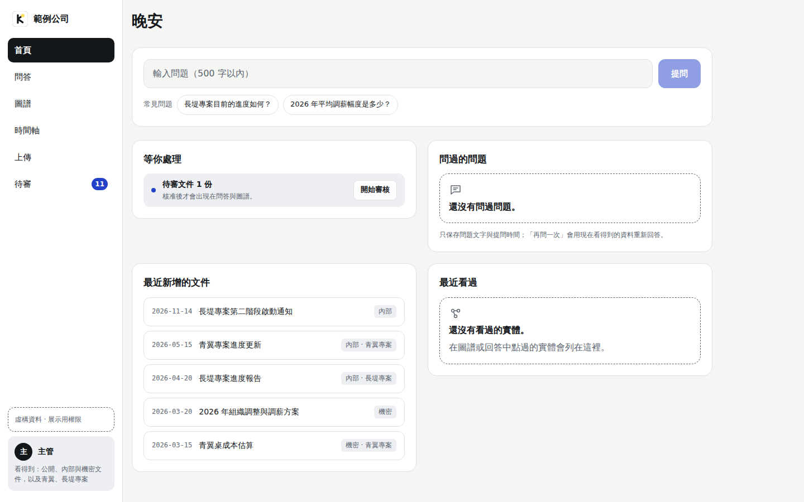

### 問答

在輸入框提問，或點常見問題。回答附上依據的段落，點引用在右側打開原文，下方列出同一題的其他出處；「回答提到」列出回答中的實體，附鄰近的小圖與「接著問」。看得到的文件中沒有答案時拒答，並在「可以試試」列出下一步（[docs/qa.md](docs/qa.md)）。

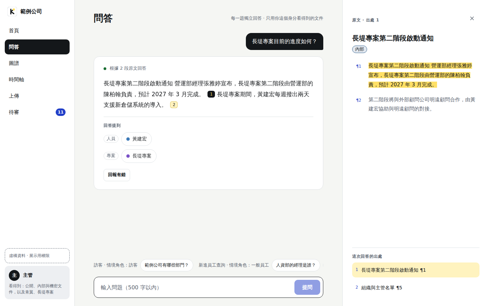

### 圖譜

文件中萃取出的實體與關係。以搜尋框或點節點選取實體，右側的實體面板列出它的關係與出現的文件，也能在問答中問它。從選取的實體逐步展開，聚焦以外的部分變灰；可依類型篩選，或以「找路徑」找兩個實體之間的最短路徑（[docs/graph.md](docs/graph.md)）。

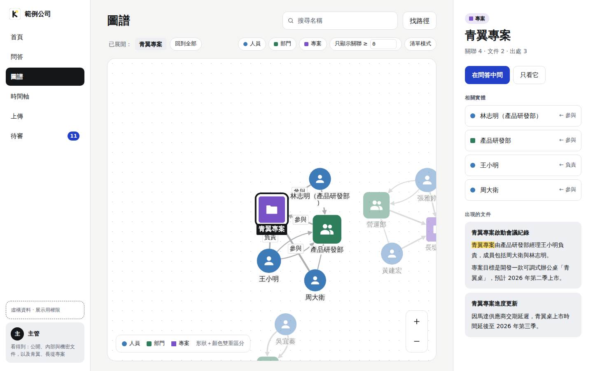

### 時間軸

依日期列出看得到的文件，以年份分組。卡片預設精簡，展開後才列出段落與「打開原文」；依實體篩選時，沒有提到它的文件變淡（[docs/graph.md](docs/graph.md#時間軸readtimeline)「時間軸」）。

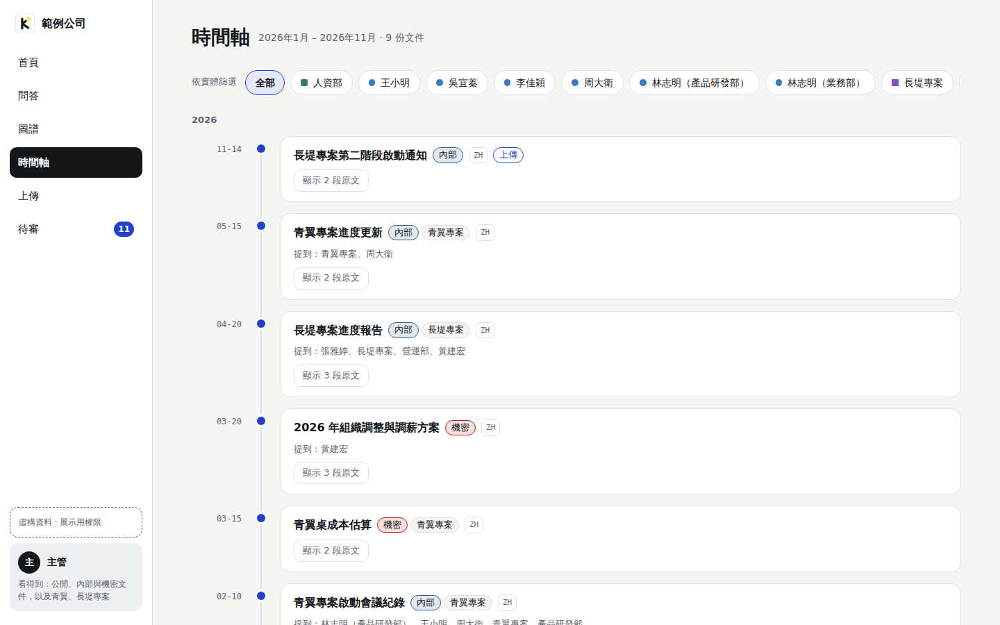

### 上傳與我的上傳

上傳檔案或貼上文字；文件切成段落，可見等級預設為目前身分能選的最嚴格等級。實體與關係在背景萃取，經過審核才寫入。「我的上傳」每份一列，附狀態（審核中、已核准、部分退回、已退回），點一份看萃取出的內容與每一項的結果（[docs/upload.md](docs/upload.md)、[docs/design.md](docs/design.md#我的上傳)）。

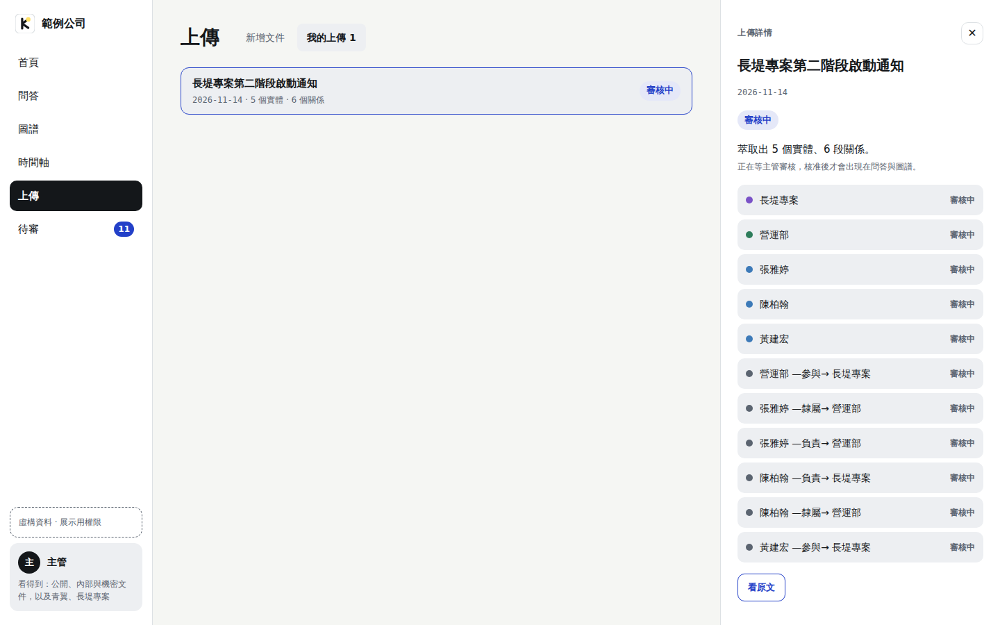

### 待審

能審核的身分核准或退回萃取的結果。系統先準備好（同名只有一個候選時預先帶入合併、圖譜已有的關係不重複建立），只把需要人決定的項目放在最上面。上傳的文件與既有段落說法不同時，標示為說法不同（[docs/extraction.md](docs/extraction.md)、[docs/conflicts.md](docs/conflicts.md)）。

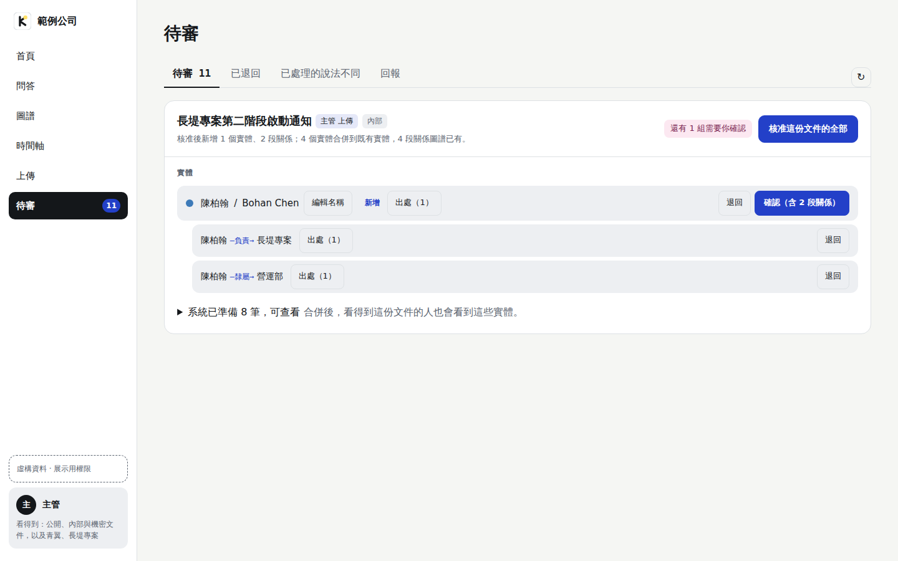

### 評測台與品質報告

交付方用的工具，網址加上 `?tools=evals` 時才顯示，只給能審核的身分。執行題庫，為引用、關鍵重點、拒答與滲漏評分；點一題看它的回答與引用。「下載品質報告」把結果做成可列印的 HTML 報告（[docs/evals.md](docs/evals.md)）。

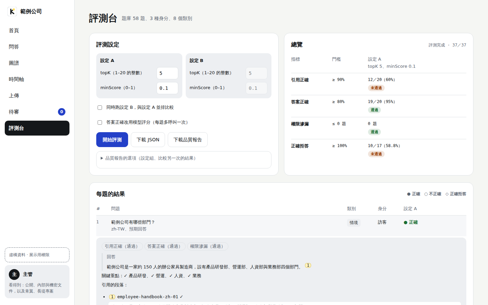

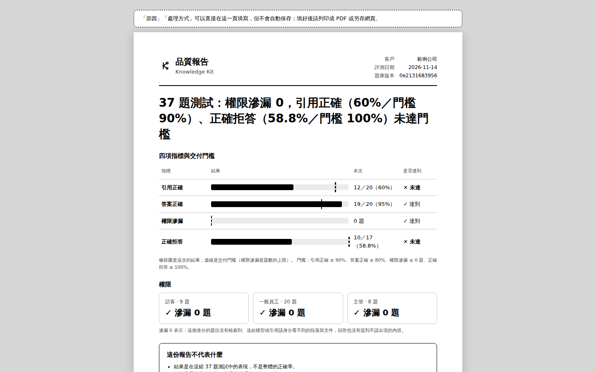

### 展示模式

網址加上 `?mode=presentation` 時是對外展示用的畫面：只有問答與圖譜、字級放大，身分是頂端列的分段切換，方便展示同一個問題在不同身分下的回答；原文以浮動卡片打開（[docs/qa.md](docs/qa.md#展示模式)「展示模式」）。

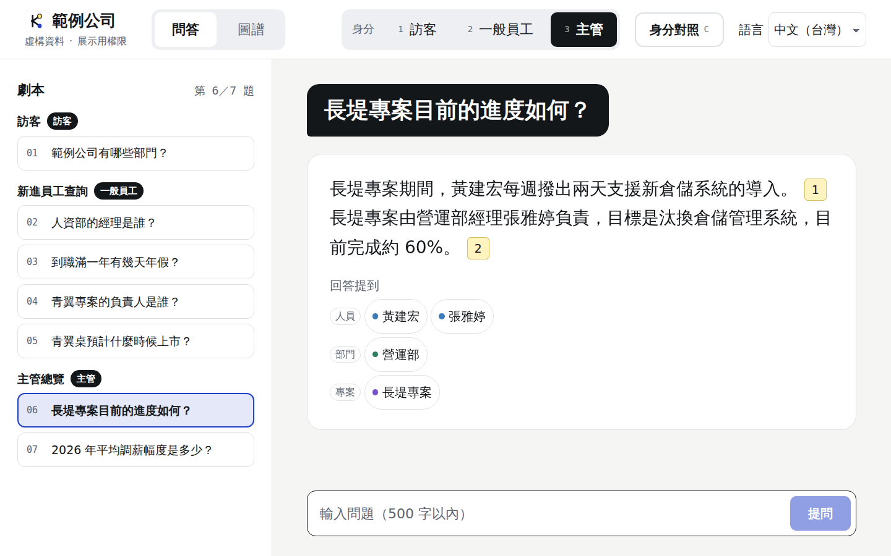

### 手機與平板

手機（600px 以下）改用底部分頁列，原文、實體、身分與語言以底部面板打開；平板（601–1024px）是左側的圖示導覽列，面板從右側滑出（[docs/design.md](docs/design.md#手機與平板)「手機與平板」）。

| 首頁 | 問答 | 圖譜 |
| --- | --- | --- |
| 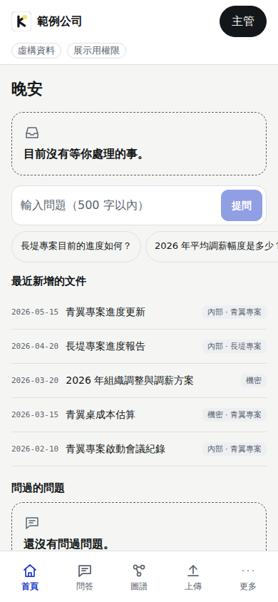 | 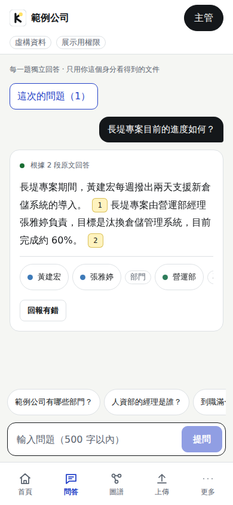 | 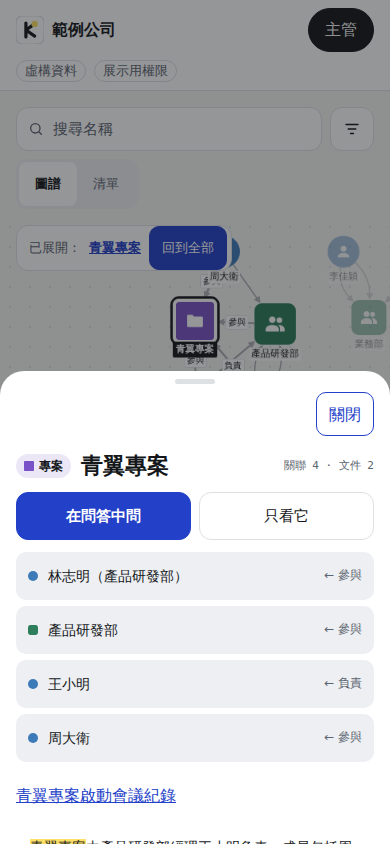 |

### 每一頁共通

- **可見等級與專案權限**：每個角色只看得到等級與專案允許的文件，由 PGlite 的 row-level security 執行（[docs/data-model.md](docs/data-model.md)）。
- **多語言介面與檢索**：介面文字來自翻譯檔，檢索依各語言的文字處理。可選用瀏覽器內的語意向量（`multilingual-e5-small`）跨語言檢索：以一種語言發問，檢索另一種語言的文件；可用虛構的多語言客戶 `clients/kestrova-demo/` 試用（[docs/client-config.md](docs/client-config.md)、[docs/retrieval.md](docs/retrieval.md#語意向量multilingual-e5-small)）。
- **主題色與深色模式**：顏色來自設定，`prefers-color-scheme: dark` 時改用深色配色（[docs/client-config.md](docs/client-config.md)）。

## 線上 demo

**試用：**<https://knowledge-kit-demo.bentsai0212.workers.dev>

- 已預先填入公開的試用碼，直接送出即可。所有訪客共用每日的提問次數，當天的額度可能用完。
- 沒有評測台（網址加上 `?tools=evals` 也一樣），因為執行一次會呼叫很多次模型。
- 問題與上傳的內容會傳給模型供應商。**不要輸入或上傳個人或機密資料。**
- 上傳的文件只存在你的瀏覽器，重新整理即消失。
- **展示模式**：網址加上 `?mode=presentation` 時只顯示問答與圖譜，適合對外展示（[docs/qa.md](docs/qa.md#展示模式)）。
- 線上 demo 使用參考情境與 `keyword-hash` 檢索，不下載模型。跨語言檢索可在本機以 `KK_CLIENT=kestrova-demo` 啟動 `clients/kestrova-demo/` 試用（[clients/README.md](clients/README.md)）。
- 想要自己的邀請碼時，以本 repo 的「索取邀請碼」Issue 範本提出。邀請碼不會貼在公開的 Issue。

## 本機快速開始

需要 Node 22 以上。

```bash
npm install
npm run dev
```

以 Vite 開發伺服器啟動參考情境（`client/`）。瀏覽圖譜、時間軸與文件不需要金鑰。評測台在網址加上 `?tools=evals` 時顯示。要問答時，用自己的 Anthropic API 金鑰在本機執行 Worker：

```bash
cp .dev.vars.example .dev.vars
npm run build
npx wrangler dev
```

執行 `npx wrangler dev` 前，在 `.dev.vars` 填入 `ANTHROPIC_API_KEY` 與自己的 `ACCESS_CODES`。`.dev.vars` 不進版本控制。

本機有兩種用法，要打開的網址不同：

| 用法 | 指令 | 打開 |
| --- | --- | --- |
| 開發與試用 | `npm run dev`，另一個終端機執行 `npx wrangler dev` | `http://localhost:5173`（目前的程式碼；8787 只負責 `/api`） |
| 檢查建置結果 | `npm run build` 後執行 `npx wrangler dev` | `http://localhost:8787` |

8787 的畫面是上一次 `npm run build` 留下的 `dist/`，客戶也是當時 `KK_CLIENT` 選的那一個。`git pull` 或切換 `KK_CLIENT` 後要重新 build，否則看到的是舊版或其他客戶的畫面。細節見 [worker/README.md](worker/README.md)。

其他指令（型別檢查、測試、客戶設定檢查、Playwright）見 [AGENTS.md](AGENTS.md) 第 2 節。

## 改成自己的版本

- **fork 之後**：依 [docs/workflow/fork.md](docs/workflow/fork.md) 修改帳號與設定。
- **新的組織**：依 playbook（[繁體中文](docs/playbook/README.md)、[English](docs/playbook/en/README.md)）進行需求確認、資料盤點、資料安全、題庫與建立步驟。設定的說明見 [docs/client-config.md](docs/client-config.md)，每個組織放在自己的資料夾（[clients/README.md](clients/README.md)）。
- **部署線上 demo**：[docs/deploy.md](docs/deploy.md)。

## 架構

```text
瀏覽器                                    Cloudflare Worker
+-------------------------------+         +------------------------------+
| Vite + React + TypeScript     |  POST   | /api/ask                     |
| PGlite (Postgres in browser)  | ------> |  access code, daily limits,  | ---> Claude Messages API
|  documents, RLS, graph,       |  SSE    |  same-site check,            |
|  retrieval, review queue      | <------ |  model allowlist             |
+-------------------------------+         | static files from dist/      |
                                          +------------------------------+
```

| 部分 | 內容 |
| --- | --- |
| `app/` | 前端：Vite、React 與 TypeScript。所有資料都在瀏覽器內的 PGlite 記憶體資料庫，載入時從 migration 與資料集重建。 |
| `worker/` | Cloudflare Worker：把 `/api/ask` 轉發到 Claude Messages API，並提供 `dist/`。檢查邀請碼、每日次數與來源（[worker/README.md](worker/README.md)）。 |
| `client/` | 參考情境的設定、翻譯檔、虛構資料集與評測題庫。 |
| `clients/` | 每個組織一個資料夾，結構與 `client/` 相同。 |

技術選型記錄在 [ADR 0001](docs/adr/0001-tech-stack.md)，其他決策見 [docs/adr/README.md](docs/adr/README.md)。

## 開發方式

本 repo 由 coding agent 依 GitHub Issue 開發，開發流程與程式一起公開：

- [AGENTS.md](AGENTS.md)：coding agent 的規則與指令。
- [docs/workflow/](docs/workflow/)：憲法與 workflow 手冊。
- [tools/workflow/runner/](tools/workflow/runner/README.md)：挑選 Issue 交給 agent 的 runner。

歡迎參考。這些是為本 repo 寫的，fork 後依 [docs/workflow/fork.md](docs/workflow/fork.md) 修改。

## 文件語言

`docs/` 的文件大多是繁體中文，`AGENTS.md` 與程式註解也是。playbook 有英文版 [docs/playbook/en/](docs/playbook/en/README.md)，README 與 [SECURITY.md](SECURITY.md) 以英文為主。

## 資料與安全

- 本 repo 與線上 demo 的資料都是虛構的。
- 權限是展示用的：資料都在瀏覽器內，不是真正的存取控制。見[資料安全說明](docs/playbook/data-security.md)。
- 金鑰只放在 Worker secret，不在 repo，也不在瀏覽器。
- 回報安全問題見 [SECURITY.md](SECURITY.md)。

## 狀態與規劃

- **v1**：上面的功能（[RFC 0001](docs/rfcs/0001-project-charter.md) 第 1 階段）與線上 demo。見[變更紀錄](CHANGELOG.md)。
- **v2.1**：產品體驗：問答頁的三欄版面、回答提到與接著問、圖譜逐步展開、待審頁由系統先準備、查不到時的下一步。見[變更紀錄](CHANGELOG.md)。
- **v2**：跨語言檢索，可選用瀏覽器內的語意向量（`multilingual-e5-small`），以虛構的多語言客戶 `clients/kestrova-demo/`（繁中、英文、日文，每個事實只寫在一種語言）實測：跨語言題六個方向共 18 題，引用與答案都 18/18（[評測結果](clients/kestrova-demo/evals/README.md#驗收結果)、[RFC 0002](docs/rfcs/0002-public-release.md)）。見[變更紀錄](CHANGELOG.md)。

## 授權

[MIT](LICENSE)
