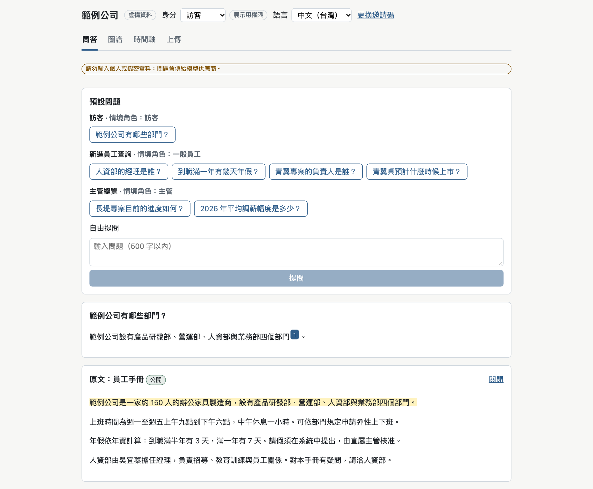
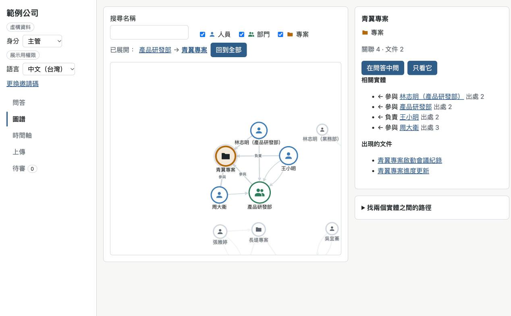
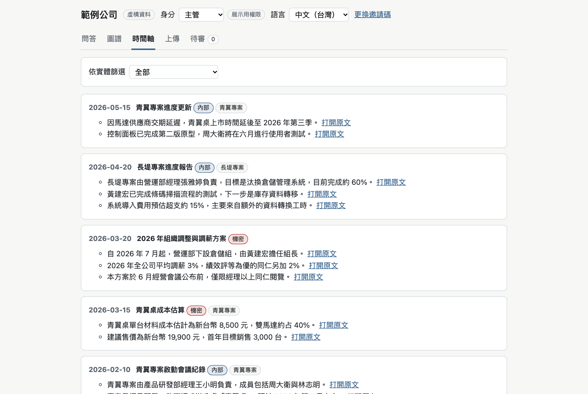
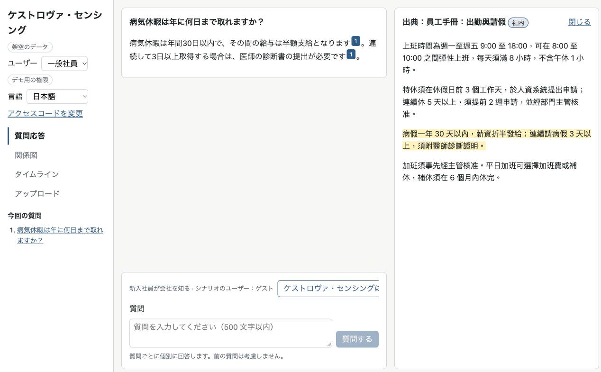

# knowledge-kit

[English](README.md) | 繁體中文

以虛構資料為一個組織快速建立「第二大腦」知識平台 demo 的 template。換組織時只改設定（`client/` 或 `clients/<名稱>/`），不改程式。

**線上 demo：**<https://knowledge-kit-demo.bentsai0212.workers.dev>（見[線上 demo](#線上-demo)）

demo 是展示用的原型，不是正式系統。

## 功能

- **附引用的問答與拒答**：回答附上依據的段落；看得到的文件中沒有答案時拒答（[docs/qa.md](docs/qa.md)）。
- **可見等級與專案權限**：每個角色只看得到等級與專案允許的文件，由 PGlite 的 row-level security 執行（[docs/data-model.md](docs/data-model.md)）。
- **知識圖譜與路徑**：文件中的實體與關係，以及兩個實體之間的最短路徑（[docs/graph.md](docs/graph.md)）。
- **時間軸**：依日期列出看得到的文件與段落（[docs/graph.md](docs/graph.md)）。
- **上傳與萃取**：上傳的文件切成段落，萃取出的實體與關係經過審核才寫入（[docs/upload.md](docs/upload.md)、[docs/extraction.md](docs/extraction.md)）。
- **說法不同的偵測**：上傳的文件與既有段落說法不同時標示出來（[docs/conflicts.md](docs/conflicts.md)）。
- **評測台**：執行題庫，為引用、關鍵重點、拒答與滲漏評分（[docs/evals.md](docs/evals.md)）。
- **多語言介面與檢索**：介面文字來自翻譯檔，檢索依各語言的文字處理（[docs/client-config.md](docs/client-config.md)、[docs/retrieval.md](docs/retrieval.md)）。可選用瀏覽器內的語意向量（`multilingual-e5-small`）跨語言檢索：以一種語言發問，檢索另一種語言的文件（[docs/retrieval.md](docs/retrieval.md#語意向量multilingual-e5-small)「語意向量」）。
- **主題色與深色模式**：顏色來自設定，`prefers-color-scheme: dark` 時改用深色配色（[docs/client-config.md](docs/client-config.md)）。

預設問題的回答，附引用並打開原文面板：



知識圖譜與實體面板（主管身分）：



時間軸的第一個畫面（主管身分）：



虛構的多語言客戶 `clients/kestrova-demo/` 的跨語言檢索（一般員工身分）：以日文發問，以日文回答，引用繁中的員工手冊段落：



## 線上 demo

**試用：**<https://knowledge-kit-demo.bentsai0212.workers.dev>

- 已預先填入公開的試用碼，直接送出即可。所有訪客共用每日的提問次數，當天的額度可能用完。
- 評測台隱藏，因為執行一次會呼叫很多次模型。
- 問題與上傳的內容會傳給模型供應商。**不要輸入或上傳個人或機密資料。**
- 上傳的文件只存在你的瀏覽器，重新整理即消失。
- **展示模式**：網址加上 `?mode=presentation` 時只顯示問答與圖譜，適合對外展示（[docs/qa.md](docs/qa.md#展示模式)）。
- 線上 demo 使用參考情境與 `keyword-hash` 檢索，不下載模型。跨語言檢索可在本機以 `KK_CLIENT=kestrova-demo` 啟動 `clients/kestrova-demo/` 試用（[clients/README.md](clients/README.md)）。
- 想要自己的邀請碼時，以本 repo 的「索取邀請碼」Issue 範本提出。邀請碼不會貼在公開的 Issue。

## 本機快速開始

需要 Node 22 以上。

```bash
npm install
npm run dev
```

以 Vite 開發伺服器啟動參考情境（`client/`）。瀏覽圖譜、時間軸與文件不需要金鑰。要問答時，用自己的 Anthropic API 金鑰在本機執行 Worker：

```bash
cp .dev.vars.example .dev.vars
npm run build
npx wrangler dev
```

執行 `npx wrangler dev` 前，在 `.dev.vars` 填入 `ANTHROPIC_API_KEY` 與自己的 `ACCESS_CODES`。`.dev.vars` 不進版本控制。與 `npm run dev` 併用等細節見 [worker/README.md](worker/README.md)。

其他指令（型別檢查、測試、客戶設定檢查、Playwright）見 [AGENTS.md](AGENTS.md) 第 2 節。

## 改成自己的版本

- **fork 之後**：依 [docs/workflow/fork.md](docs/workflow/fork.md) 修改帳號與設定。
- **新的組織**：依 playbook（[繁體中文](docs/playbook/README.md)、[English](docs/playbook/en/README.md)）進行需求確認、資料盤點、資料安全、題庫與建立步驟。設定的說明見 [docs/client-config.md](docs/client-config.md)，每個組織放在自己的資料夾（[clients/README.md](clients/README.md)）。
- **部署線上 demo**：[docs/deploy.md](docs/deploy.md)。

## 架構

```text
瀏覽器                                    Cloudflare Worker
+-------------------------------+         +------------------------------+
| Vite + React + TypeScript     |  POST   | /api/ask                     |
| PGlite (Postgres in browser)  | ------> |  access code, daily limits,  | ---> Claude Messages API
|  documents, RLS, graph,       |  SSE    |  same-site check,            |
|  retrieval, review queue      | <------ |  model allowlist             |
+-------------------------------+         | static files from dist/      |
                                          +------------------------------+
```

| 部分 | 內容 |
| --- | --- |
| `app/` | 前端：Vite、React 與 TypeScript。所有資料都在瀏覽器內的 PGlite 記憶體資料庫，載入時從 migration 與資料集重建。 |
| `worker/` | Cloudflare Worker：把 `/api/ask` 轉發到 Claude Messages API，並提供 `dist/`。檢查邀請碼、每日次數與來源（[worker/README.md](worker/README.md)）。 |
| `client/` | 參考情境的設定、翻譯檔、虛構資料集與評測題庫。 |
| `clients/` | 每個組織一個資料夾，結構與 `client/` 相同。 |

技術選型記錄在 [ADR 0001](docs/adr/0001-tech-stack.md)，其他決策見 [docs/adr/README.md](docs/adr/README.md)。

## 開發方式

本 repo 由 coding agent 依 GitHub Issue 開發，開發流程與程式一起公開：

- [AGENTS.md](AGENTS.md)：coding agent 的規則與指令。
- [docs/workflow/](docs/workflow/)：憲法與 workflow 手冊。
- [tools/workflow/runner/](tools/workflow/runner/README.md)：挑選 Issue 交給 agent 的 runner。

歡迎參考。這些是為本 repo 寫的，fork 後依 [docs/workflow/fork.md](docs/workflow/fork.md) 修改。

## 文件語言

`docs/` 的文件大多是繁體中文，`AGENTS.md` 與程式註解也是。playbook 有英文版 [docs/playbook/en/](docs/playbook/en/README.md)，README 與 [SECURITY.md](SECURITY.md) 以英文為主。

## 資料與安全

- 本 repo 與線上 demo 的資料都是虛構的。
- 權限是展示用的：資料都在瀏覽器內，不是真正的存取控制。見[資料安全說明](docs/playbook/data-security.md)。
- 金鑰只放在 Worker secret，不在 repo，也不在瀏覽器。
- 回報安全問題見 [SECURITY.md](SECURITY.md)。

## 狀態與規劃

- **v1**：上面的功能（[RFC 0001](docs/rfcs/0001-project-charter.md) 第 1 階段）與線上 demo。見[變更紀錄](CHANGELOG.md)。
- **v2**：跨語言檢索，可選用瀏覽器內的語意向量（`multilingual-e5-small`），以虛構的多語言客戶 `clients/kestrova-demo/`（繁中、英文、日文，每個事實只寫在一種語言）實測：跨語言題六個方向共 18 題，引用與答案都 18/18（[評測結果](clients/kestrova-demo/evals/README.md#驗收結果)、[RFC 0002](docs/rfcs/0002-public-release.md)）。見[變更紀錄](CHANGELOG.md)。

## 授權

[MIT](LICENSE)
