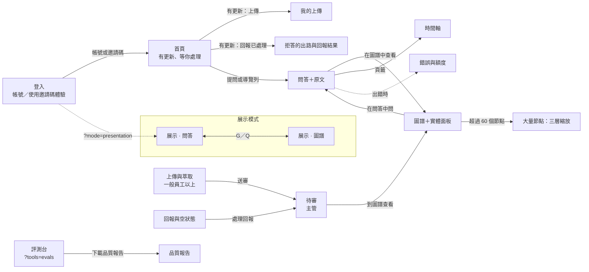

# 設計稿 v1 總覽

本文件是 Knowledge Kit **設計稿 v1** 的總覽，對應設計畫布「Knowledge Kit 新設計」的「00 設計稿總覽」頁（#278）。**之後的設計與實作都從這裡開始**：先看有哪些畫面、畫面之間怎麼切換、使用者流程與已定的決策，再到 [design.md](../../design.md) 找數值與規則。

- 設計規格（實作依據）：[design.md](../../design.md)；決策與理由：[ADR 0008](../../adr/0008-design-system.md)
- 動態的 keyframes 原始碼：[motion-reference.md](../motion-reference.md)
- 改動 v1 的畫面或流程時，同一個 PR 更新本文件；整體改版時另開 `docs/design/v2/`，本文件保留為 v1 的紀錄。
- **視覺（版面、尺寸、層次、元件樣式）以畫面流程圖引用的畫板為準**：畫板原始碼在 [boards/](boards/README.md)（對照表、顏色名稱與 token、不實作的內容都在那裡）；[design.md](../../design.md) 是規則與數值的文字說明（#329）。
- **優先順序**：權限與行為的決定（#247 等 Issue 的 `## 決定`、ADR）＞ 畫板 ＞ [design.md](../../design.md) 的文字。畫板與決定衝突時以決定為準，在對應的視覺對齊 Issue 中逐項註明；已知的衝突列在 [boards/README.md](boards/README.md)「已知與決定衝突的地方」。

## 原則

1. **出處是主角**：證據色只用在引用標號與原文螢光；主色只代表「可以操作」。
2. **誠實的空白**：查不到、說法不同、空狀態都說明原因並給下一步；沒有權限的內容當作不存在（#247）。
3. **動態只解釋因果**：文件 → 結構 → 證據；等待時說真話；減少動態時直接到位。
4. **一份 token，兩種光線**：Light 與 Dark 只換顏色，行為與動態相同；換客戶只改 `client/`。

## 目錄

畫布的每一頁、內容與 repo 中的狀態。

| 畫布頁 | 內容 | 狀態 |
| --- | --- | --- |
| 00 設計稿總覽 | 封面、目錄、頁面地圖、使用者流程 | 本文件 |
| 日常工具 | 登入、首頁、我的上傳、拒答的出路與回報結果、手機版（knowledge-kit 中為展示） | 規格：#278；回報結果需要 migration（實作 Issue 以 plan-first 討論） |
| 統一設計系統（Light／Dark） | 25 個顏色 token、引用標號三狀態、實體顏色推導、字體、圓角、焦點框 | docs/design.md（#224）、ADR 0008；已實作 #225 |
| 補齊畫面 | 入口（主視覺）、時間軸、評測台、待審、空狀態與回報 | 入口 #228；時間軸、評測台、待審、空狀態與回報已實作（#241–#245） |
| 大量節點・手機版 | 三層語意縮放；手機的問答、原文、身分、圖譜、實體、入口 | docs/design.md（#253）；實作 Issue #254–#257 |
| 大量節點・手機版（下方） | 手機的時間軸、上傳、待審、評測台、更多 | 規格：#278 |
| 平板 | 601–1024px：直向首頁與問答、橫向圖譜；72px 圖示導覽列、從右滑出的面板 | 規格：#278 |
| 英文版面 | 332 條文字實測寬度；4 處要調整（手機分段、說法不同的決定、節點名稱、品質報告）與排版規則 | 規格：#278 |
| 圖譜鍵盤與報讀 | 方向鍵沿著關係移動、每一步的報讀句型、清單模式；可試走 | 規格：#278 |
| 展示模式 | 字級、劇本、身分對照、主持人快捷鍵、放大的圖譜 | docs/design.md（#259）；實作 Issue #260–#262 |
| 錯誤與額度 | 五類錯誤、位置與下一步、額度用完的狀態 | 規格：#278 |
| 品質報告 | A4 兩頁：結論與指標、附錄與測試條件 | 規格：#278 |
| 產品 Icon | K 晶格：三個概念、規格、結晶載入動態 | docs/design.md（#224）；已實作 #226 |
| 動態提案 | 原則、刻度、全互動對照表、四個流程的可播放動態 | docs/design.md（#224）、keyframes 參考檔（#251）；問答已實作 #227 |
| 提案 A／提案 B | 墨與螢光（Light）、晶格 Lattice（Dark）的原始提案 | 已併入統一設計系統；依 #247 修正過 |

## 已定的決策

- **ADR 0008**：A 當 Light、B 當 Dark，共用一份 token；證據色固定、客戶不能改；說法不同用洋紅；Dark 的原文仍放在亮色紙面。
- **#247**：沒有權限的內容當作不存在：不顯示數量、上鎖框或任何「被隱藏」的痕跡；要展示權限時，說明看得到什麼。
- **#31 決定 2、#241 決定**：時間軸只列出介面語言的文件；同一份文件的多語言版本合併另見 #263，暫不排入。
- **Icon**：K 晶格：書背長出節點，右上是證據節點；下方節點讀 primary、證據節點讀 mark。
- **入口**：左側是沒有文字的知識圖譜動態（三層景深），右側是邀請碼面板；跟隨系統的 Light／Dark。
- **#258**：展示模式：點劇本的問題自動切到情境身分；做身分對照（所有身分並排）；預設 Light。
- **日常工具**：往日常工具走，但在 knowledge-kit 是展示：資料仍只在記憶體；登入頁有帳號登入（展示帳號，不能切換身分）與使用邀請碼體驗（可以切換身分）兩條路，`/api/ask` 仍以邀請碼把關，fork 時帳號登入換成真的身分驗證；首頁問候依本地時間、不顯示名字；通知只在產品內。
- **分支**：設計規格用 design/ 分支，只放設計規格與素材，不改程式。
- **流程**：設計在畫布上進行；開發告一段落後，一次寫進 repo，由決策中心（Claude Project）審核與合併。

## 還沒設計／待決定

- 字型的取得方式（自備或系統字型）
- 回報結果回到回報的人：需要新的 migration（回報的人讀得到自己的回報、處理說明），以及要更新 ADR 0007 還是另開 ADR
- 展示模式的身分對照（#261）：前端拿不到剩餘提問次數（Worker 只在用完時回 429），「開啟前若剩餘次數不足」的驗收條件做不到；建議改為「額度用完時，已完成的欄保留，之後的欄不再送出」

## 頁面地圖

依 `client/access.json` 的參考情境（訪客、一般員工、主管）與網址參數。頁面是否顯示只是畫面安排，資料可見範圍一律由 RLS 依身分決定。

| 頁面 | 訪客 | 一般員工 | 主管 | 展示模式／線上 demo | 畫板 |
| --- | --- | --- | --- | --- | --- |
| 登入（帳號／邀請碼） | ✓ 展示帳號或邀請碼 | ✓ 展示帳號或邀請碼 | ✓ 展示帳號或邀請碼 | 帳號登入不能切換身分；邀請碼體驗與展示模式可以切換 | 補齊 · 入口、日常工具 · 登入 |
| 首頁 | ✓ | ✓ | ✓ 含「等你處理」 | 展示：不顯示，直接進問答 | 日常工具 · 首頁 |
| 問答 | ✓ 公開文件 | ✓ 公開＋內部（青翼） | ✓ 全部 | 展示：放大、劇本、身分對照 | 提案 A 問答、日常工具 · 拒答與回報結果、展示 · 問答、手機 |
| 圖譜 | ✓ | ✓ | ✓ | 展示：放大、鍵盤焦點 | 提案 B 工作台、大量節點、展示 · 圖譜 |
| 時間軸 | ✓ | ✓ | ✓ | 展示：隱藏 | 補齊 · 時間軸、手機 |
| 上傳（含我的上傳） | — | ✓ | ✓ | 展示：隱藏 | 提案 B 上傳、日常工具 · 我的上傳、手機 |
| 待審（含回報） | — | — | ✓ | 展示：隱藏 | 補齊 · 待審、空狀態與回報、手機 |
| 評測台 | — | — | ✓ 需 `?tools=evals` | 展示、線上 demo：隱藏 | 補齊 · 評測台、品質報告、手機 |

網址參數：`?mode=presentation` 只留問答與圖譜；`?tools=evals` 才顯示評測台（只給能審核的身分）；線上 demo（`VITE_ONLINE_DEMO`）隱藏評測台。三者可同時開啟，頁籤取交集。

### 三種螢幕的骨架

| 寬度 | 骨架 |
| --- | --- |
| ≥ 1025px（桌機） | 左側導覽、中間內容、右側原文／實體面板（三欄） |
| 601–1024px（平板） | 72px 圖示導覽列＋兩欄；原文與實體從右側滑出覆蓋（最寬 420px） |
| ≤ 600px（手機） | 頂端列＋底部分頁列；原文、身分與語言、實體改用底部面板 |

## 畫面流程圖

畫面之間的轉換。頁籤（問答、圖譜、時間軸、上傳、待審、評測台）彼此都能直接切換，依身分只顯示可用的頁籤；圖上只畫情境中的轉換。虛線是出錯時。

手機（≤ 600px）的轉換：登入 → 首頁 → 底部分頁列（一般員工：首頁、問答、圖譜、時間軸、上傳；主管：首頁、問答、圖譜、上傳、更多）。點引用標號、節點時從底部升起原文、實體面板；主管的「更多」收納時間軸、待審與評測台。平板沒有底部分頁列，面板從右側滑出。

## 使用者流程

每一步右欄是對應的畫板（畫布頁 · 畫板）。

### F1 第一次進入

**誰**：所有身分　**目標**：登入後到首頁，開始提問

| # | 步驟 | 說明 | 畫板 |
| --- | --- | --- | --- |
| 01 | 打開 demo 連結 | 左側是沒有文字的知識圖譜動態，右側是登入面板 | 補齊畫面 · 入口、日常工具 · 登入 |
| 02 | 帳號登入或使用邀請碼體驗 | 帳號登入：選一個展示帳號（固定身分，密碼欄停用、不送出）；邀請碼體驗：與現行相同，可以切換身分。fork 時帳號登入換成真的身分驗證 | 日常工具 · 登入 |
| 03 | 語意模型在背景下載 | 顯示真實 MB 進度；現在送出的問題會在模型準備好後回答 | 動態提案 · 全域與等待 |
| 04 | 進入首頁 | 身分徽章顯示你是誰、看得到哪些範圍；語言在徽章的面板切換 | 日常工具 · 首頁 |
| 05 | 提問或進入頁籤 | 用首頁的提問框與常見問題，或從導覽列到問答、圖譜 → 見 F2 | 日常工具 · 首頁 |

分支：

- 第 2 步 · **沒有公開碼的部署**：帳號登入頁也要輸入邀請碼（`/api/ask` 以邀請碼把關）（日常工具 · 登入）
- 第 2 步 · **邀請碼錯誤**：說明往下展開、保留輸入，不搖晃（錯誤與額度 · 狀態）
- 第 3 步 · **模型下載失敗**：改用關鍵字檢索的提示，常駐；仍可提問（錯誤與額度 · 分類）
- 第 4 步 · **展示模式**：`?mode=presentation` 不經首頁，直接進問答 → 見 F7（展示模式 · 問答）

### F2 問答與出處

**誰**：所有身分　**目標**：得到有出處的答案，並能回到原文

| # | 步驟 | 說明 | 畫板 |
| --- | --- | --- | --- |
| 01 | 選預設問題或輸入問題 | 問題泡泡從輸入框升上對話區 | 動態提案 · AI 問答 |
| 02 | 檢索原文 | 找到的段落以小卡逐張出現 | 動態提案 · AI 問答 |
| 03 | 回答逐句出現 | 每句完成後，引用標號才彈出（證據最後到） | 動態提案 · AI 問答 |
| 04 | 點引用標號 | 原文從右側滑入，螢光刷過引用的段落 | 提案 A · 問答 |
| 05 | 看「回答提到」 | 回答完成後實體逐一出現 | 提案 A · 問答 |
| 06 | 在圖譜中查看／接著問 | 轉到圖譜或用建議問題繼續 | 提案 B · 圖譜工作台 |

分支：

- 第 3 步 · **查不到**：拒答附具體的下一步（在圖譜看、問負責的人、換個問法）；不區分沒寫還是沒權限（日常工具 · 拒答與回報結果）
- 第 4 步 · **說法不同**：兩種說法並列，標出各自的出處（提案 A · 問答）
- 第 2 步 · **暫時錯誤或額度用完**：回答位置的卡片＋重新提問；額度用完時停用提問（錯誤與額度 · 狀態）
- 第 5 步 · **回報有錯**：回答下方展開表單 → 見 F5（補齊畫面 · 空狀態與回報）

### F3 切換身分看權限

**誰**：使用邀請碼體驗的人、主持人（展示）　**目標**：看見同一題在不同身分下的答案不同

| # | 步驟 | 說明 | 畫板 |
| --- | --- | --- | --- |
| 01 | 切換身分 | 使用邀請碼體驗或展示模式時，從身分面板切換；以帳號登入時不能切換，要換身分就登出後選另一個帳號 | 手機 · 問答、原文、身分 |
| 02 | 畫面更新 | 看不到的內容淡出、其餘補位；不留任何痕跡 | 動態提案 · 全域與等待 |
| 03 | 同一題再問 | 只檢索這個身分看得到的段落 | 提案 A · 問答 |
| 04 | 得到不同的答案 | 或得到與一般拒答相同的拒答 | 提案 A · 拒答・權限・矛盾 |
| 05 | 身分對照（展示模式） | 同一題以所有身分並排回答 | 展示模式 · 問答 |

分支：

- 第 5 步 · **額度在對照中途用完**：已完成的欄保留，之後的欄顯示額度訊息、不再送出（錯誤與額度 · 分類）

### F4 建立知識：上傳到併入圖譜

**誰**：一般員工上傳 → 主管審核　**目標**：文件變成可問、可查的知識

| # | 步驟 | 說明 | 畫板 |
| --- | --- | --- | --- |
| 01 | 拖放或選擇檔案（一般員工） | 框線變實線、圖示上浮；放下後檔案卡片落定 | 動態提案 · 上傳與萃取 |
| 02 | 讀取與預覽 | 段落數與預覽段落 | 動態提案 · 上傳與萃取 |
| 03 | 確認誰看得到 | 可見等級與專案 | 動態提案 · 上傳與萃取 |
| 04 | 萃取（背景） | 批次依真實進度填滿；原文畫出類型色底線 | 提案 B · 上傳與萃取 |
| 05 | 比對說法不同 | 標出與既有說法不同的句子 | 動態提案 · 上傳與萃取 |
| 06 | 送審 | 送出後顯示四步進度：主管核准後才出現在問答與圖譜 | 日常工具 · 我的上傳 |
| 07 | 審核（主管） | 合併、核准、退回；toast 可撤銷 | 補齊畫面 · 待審 |
| 08 | 併入圖譜（一般員工） | 上傳的人在首頁「有更新」與「我的上傳」看到結果 | 日常工具 · 我的上傳 |

分支：

- 第 2 步 · **讀取失敗**：原地說明＋重新選檔（錯誤與額度 · 分類）
- 第 4 步 · **批次失敗**：保留已完成的批次，可重試（錯誤與額度 · 分類）
- 第 7 步 · **需逐筆決定**：合併到既有實體或建立新實體；名稱缺語言先填寫（補齊畫面 · 待審）
- 第 7 步 · **說法不同**：並存／新說法取代／不算說法不同（動態提案 · 審核與說法不同）

### F5 回報與修正

**誰**：任何身分回報 → 主管處理　**目標**：錯誤的內容被找出並撤回

| # | 步驟 | 說明 | 畫板 |
| --- | --- | --- | --- |
| 01 | 按「回報有錯」（任何身分） | 選原因（6 類）、選填說明 | 補齊畫面 · 空狀態與回報 |
| 02 | 送出 | 只留下「已送出回報」，同一題不再回報 | 補齊畫面 · 空狀態與回報 |
| 03 | 待審 › 回報（主管） | 回報卡片：原因、回報者、問題、當時的回答 | 補齊畫面 · 空狀態與回報 |
| 04 | 打開原文判斷 | 原文紙面＋螢光 | 提案 A · 問答 |
| 05 | 判斷並修正 | 不是錯誤，或到圖譜撤回此文件對實體的核准 | 補齊畫面 · 空狀態與回報 |
| 06 | 寫說明並標示 | 不是錯誤或已撤回，附選填說明（需 migration） | 日常工具 · 拒答與回報結果 |
| 07 | 回報的人看到結果（回報的人） | 原本的回答下方與首頁「有更新」 | 日常工具 · 拒答與回報結果 |

分支：

- 第 5 步 · **撤回核准**：先預覽：會消失的節點變虛線；確認後縮小退場（動態提案 · 原則與對照表）

### F6 評測與交付

**誰**：主管（`?tools=evals`）　**目標**：用數字證明品質，交給客戶一份報告

| # | 步驟 | 說明 | 畫板 |
| --- | --- | --- | --- |
| 01 | 打開評測台（主管） | 題庫 58 題、3 種身分、8 種類別 | 補齊畫面 · 評測台 |
| 02 | 設定 A／B | topK、minScore；可選模型評分 | 補齊畫面 · 評測台 |
| 03 | 確認呼叫次數 | 對話框列出最多呼叫幾次 | 動態提案 · 全域與等待 |
| 04 | 評測中 | 每題結果回來就填一格 | 動態提案 · 全域與等待 |
| 05 | 看總覽 | 四項指標對照交付門檻 | 補齊畫面 · 評測台 |
| 06 | 只看兩組不同 | 展開單題看回答與引用 | 補齊畫面 · 評測台 |
| 07 | 下載品質報告 | A4 兩頁：結論與附錄 | 品質報告 |
| 08 | 填寫並列印 | 原因、處理方式 → 列印成 PDF 交給客戶 | 品質報告 |

分支：

- 第 3 步 · **每日上限可能不夠**：提醒先調整上限；不夠時會中途停止（補齊畫面 · 評測台）
- 第 4 步 · **手動停止**：已完成的結果保留，報告標「不判定」（品質報告）

### F7 對客戶簡報

**誰**：主持人（`?mode=presentation`）　**目標**：在會議室裡照劇本展示賣點

| # | 步驟 | 說明 | 畫板 |
| --- | --- | --- | --- |
| 01 | 開啟展示模式 | 預設 Light、字級放大；只有問答與圖譜 | 展示模式 · 原則與規格 |
| 02 | 劇本第一題 | 自動切到情境身分並送出 | 展示模式 · 問答 |
| 03 | 講解答案與出處 | S 打開原文，22px 紙面 | 展示模式 · 問答 |
| 04 | 身分對照 | C：所有身分並排，展示權限滲漏 0 | 展示模式 · 問答 |
| 05 | 切到圖譜 | G；方向鍵沿關係移動，Enter 選取 | 展示模式 · 圖譜 |
| 06 | 下一題 | →：照劇本往下 | 展示模式 · 問答 |

分支：

- 第 2 步 · **模型忙碌或逾時**：回答位置的卡片，主持人可重新提問（錯誤與額度 · 狀態）
- 第 4 步 · **額度在對照中途用完**：已完成的欄保留（錯誤與額度 · 分類）

### F8 日常回訪

**誰**：一般員工、主管　**目標**：回來時接得上上次的事

| # | 步驟 | 說明 | 畫板 |
| --- | --- | --- | --- |
| 01 | 帳號登入 | 選自己的展示帳號，身分固定；fork 時換成真的身分驗證 | 日常工具 · 登入 |
| 02 | 首頁 | 依本地時間的問候（不顯示名字）、提問框、常見問題、問過的問題、最近新增的文件 | 日常工具 · 首頁 |
| 03 | 看「有更新」（一般員工） | 上傳已核准或退回、回報已處理 | 日常工具 · 首頁 |
| 04 | 打開我的上傳 | 每一項核准或退回的結果；退回的修正後再上傳 | 日常工具 · 我的上傳 |
| 05 | 看回報結果 | 原本的回答下方顯示處理結果與說明 | 日常工具 · 拒答與回報結果 |
| 06 | 看「等你處理」（主管） | 待審文件與回報的數量 | 日常工具 · 首頁 |
| 07 | 審核與處理回報 | 結果回到上傳與回報的人的首頁 | 補齊畫面 · 待審 |

分支：

- 第 2 步 · **再問一次**：問過的問題只存文字，用現在看得到的資料重新回答（日常工具 · 首頁）
- 第 5 步 · **已撤回**：「再問一次」看更新後的答案（日常工具 · 拒答與回報結果）

## 全部介面

畫布上的每一張畫板。「提案 A／提案 B」是原始提案，已併入統一設計系統，只供參考。

| 畫布頁 | 畫板 | 尺寸 |
| --- | --- | --- |
| 00 設計稿總覽 | 總覽 · 封面、目錄與決策 | 1440×1800 |
| 00 設計稿總覽 | 總覽 · 頁面地圖（身分 × 模式 × 尺寸） | 1440×1160 |
| 00 設計稿總覽 | 總覽 · 使用者流程 | 2400×2900 |
| 00 設計稿總覽 | 總覽 · 畫面流程圖（畫面之間怎麼切換） | 2160×2020 |
| 00 設計稿總覽 | 總覽 · 全部介面 | 1872×5312 |
| 日常工具 | 日常工具 · 原則、搬移與前提 | 1440×1300 |
| 日常工具 | 日常工具 · 首頁（可切換一般員工／主管） | 1440×1000 |
| 日常工具 | 日常工具 · 送出後與我的上傳（可點選） | 1440×1000 |
| 日常工具 | 日常工具 · 拒答的出路與回報結果（可切換） | 1440×1000 |
| 日常工具 | 日常工具 · 登入（帳號登入與使用邀請碼體驗） | 1440×900 |
| 日常工具 | 日常工具 · 手機：登入、首頁、我的上傳 | 2400×1080 |
| 統一設計系統（Light／Dark） | 統一 token 對照表 v1 | 1440×2360 |
| 補齊畫面 | 補齊 · 入口：邀請碼與首次載入 | 1440×900 |
| 補齊畫面 | 補齊 · 時間軸 | 1440×1000 |
| 補齊畫面 | 補齊 · 評測台 | 1440×1120 |
| 補齊畫面 | 補齊 · 待審完整頁 | 1440×1000 |
| 補齊畫面 | 補齊 · 空狀態與回報清單 | 1440×1120 |
| 大量節點・手機版 | 大量節點時的圖譜（可切換層級） | 1440×1180 |
| 大量節點・手機版 | 手機 · 問答、原文、身分 | 1440×1080 |
| 大量節點・手機版 | 手機 · 入口、圖譜、實體 | 1440×1080 |
| 大量節點・手機版 | 手機 · 時間軸、上傳、待審、評測台、更多 | 2400×1080 |
| 平板 | 平板 · 直向首頁與問答、橫向圖譜（601–1024px） | 2880×1440 |
| 英文版面 | 英文版面檢查：實測寬度、需調整的 4 處與規則 | 2400×1880 |
| 圖譜鍵盤與報讀 | 圖譜的鍵盤與螢幕報讀器（可試走） | 2400×1720 |
| 展示模式 | 展示模式 · 原則與規格 | 1440×1180 |
| 展示模式 | 展示模式 · 問答（1920×1080，可操作） | 1920×1080 |
| 展示模式 | 展示模式 · 圖譜（1920×1080） | 1920×1080 |
| 錯誤與額度 | 錯誤與額度 · 分類與原則 | 1440×1240 |
| 錯誤與額度 | 錯誤與額度 · 問答中的各種狀態（可切換） | 1440×1000 |
| 品質報告 | 品質報告 · A4 兩頁（列印版面） | 2160×1380 |
| Light · 墨與螢光（A） | 設計方向：墨與螢光 | 1440×1080 |
| Light · 墨與螢光（A） | 問答（附出處） | 1440×960 |
| Light · 墨與螢光（A） | 知識圖譜 | 1440×960 |
| Light · 墨與螢光（A） | 動態系統（可播放） | 1440×1320 |
| Light · 墨與螢光（A） | 拒答・權限・矛盾 | 1440×1000 |
| Dark · 晶格 Lattice（B） | B · 設計方向：晶格 | 1440×1120 |
| Dark · 晶格 Lattice（B） | B · 圖譜工作台 | 1440×960 |
| Dark · 晶格 Lattice（B） | B · 上傳與萃取 | 1440×960 |
| Dark · 晶格 Lattice（B） | B · 動態系統（可播放） | 1440×1240 |
| 產品 Icon | Icon · 三個概念 | 1440×960 |
| 產品 Icon | Icon · 推薦：K 晶格規格 | 1440×1340 |
| 產品 Icon | Icon · 結晶載入動態（可播放） | 1440×660 |
| 動態提案 | 動態 · 原則、刻度與全互動對照表 | 1440×1960 |
| 動態提案 | 動態 · AI 問答（可播放） | 1440×1000 |
| 動態提案 | 動態 · 上傳與萃取（可播放） | 1440×1000 |
| 動態提案 | 動態 · 審核與說法不同（可播放） | 1440×1000 |
| 動態提案 | 動態 · 全域與等待狀態（可播放） | 1440×1000 |
