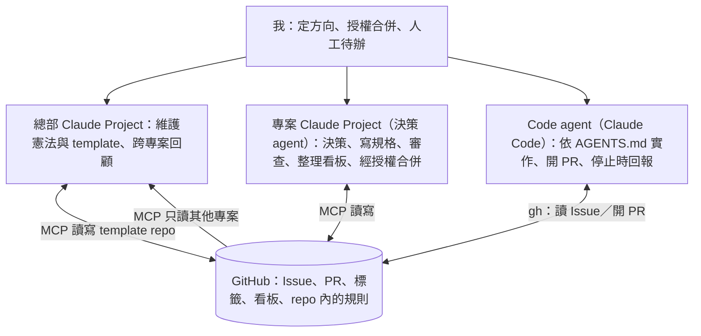
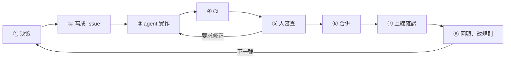

# 個人開發 Workflow 憲法

- 版本：v0.18（2026-11-07）；各版內容見文末「版本紀錄」
- 正本：建立本專案的 template repo 中的同名檔案（`docs/workflow/constitution.md`）
- 從 template 建立的專案保留一份副本。副本只能從 template 升級，不在專案內直接修改；值得改的規則回到 template 修憲（第 10 節）。

本憲法定義我所有程式專案共用的工作方式：**Claude Project 做決策、coding agent 做實作、GitHub 記錄一切。** 內容來自實際專案（2026-10-11～12）的運作。規則標示「已驗證」（實際跑過）或「試驗中」（尚未驗證）。

讀者是人與 Claude Project。coding agent 不需要讀本文件，它的規則在 `AGENTS.md` 與 `docs/workflow/agent-workflow.md`。

## 0. 文件關係

| 文件 | 讀者 | 內容 |
| --- | --- | --- |
| `docs/workflow/constitution.md` | 人、Claude Project | 原則與分工（本文件） |
| `docs/workflow/decision-center.md` | Claude Project | 決策中心的操作手冊 |
| `docs/workflow/modules.md` | 人、Claude Project | 模組內容與啟用方式 |
| `AGENTS.md` | coding agent | 專案設定、指令、硬規則 |
| `docs/workflow/agent-workflow.md` | coding agent | 實作一張 Issue 的步驟 |
| `docs/workflow/github-writes.md` | Claude Project | 決策 agent 寫入 GitHub 的三級確認與合併授權（正本） |
| `docs/workflow/upgrade.md` | 人、Claude Project、coding agent | 已建立的專案升級 template 的程序 |

手冊不得與憲法衝突；發現衝突時以憲法為準，並開 Issue 修正手冊。

## 1. 核心原則

十一條原則優先於後面所有規則；規則之間衝突時，回到這裡判斷。

| # | 原則 | 意思 | 狀態 |
| --- | --- | --- | --- |
| 1 | GitHub 是唯一事實來源 | 工作、決定、待辦都在 Issue／PR／看板；對話裡的結論在寫進 GitHub 之前不算數 | 已驗證 |
| 2 | 規則寫進 repo | 規則放 repo 才能跨工具共用；以 main 上的內容為準 | 已驗證 |
| 3 | 人把關方向與合併 | 方向在 Issue 階段確認；合併永遠由人決定，agent 只在人同意後執行 | 已驗證 |
| 4 | Issue 就是規格 | 目標、驗收條件、不做什麼、依賴；驗收條件就是完成標準 | 已驗證 |
| 5 | 寫給 agent 的先查證 | 規格與規則寫出前先核對事實與資料；範圍描述要精確 | 已驗證 |
| 6 | 測試反壓 | 能自動驗證的先寫成測試或 CI；不得宣稱未執行的檢查已通過 | 已驗證 |
| 7 | 小步、可回退 | 一張 Issue 一個 PR，目標 400 行內；未完成功能用預設關閉的開關 | 已驗證 |
| 8 | 停下來也要留紀錄 | agent 卡住時在 GitHub 回報，人以 `## 決定` 回覆（只採信可信身分寫的，見 [agent-workflow.md](agent-workflow.md#0-前置檢查) 第 0 步）；不只在本機對話 | 已驗證 |
| 9 | 每次失誤都改 harness | 因規則缺漏而做錯，就在同一個 PR 補規則；每條規則附來源與可刪條件，沒有來源的不加、過時的刪掉 | 已驗證 |
| 10 | 人的注意力是最稀缺資源 | 以「一個決定到上線，人要碰幾次」衡量流程；審查依風險分配 | 試驗中 |
| 11 | 能用程式擋的不只寫成文字 | 文字規則是建議，hook 與 CI 才保證執行；高風險且明確的規則優先程式化 | 試驗中 |

## 2. 角色與分工



| 角色 | 負責 | 不負責 |
| --- | --- | --- |
| 人 | 定方向、授權合併、`needs-human` 待辦、repo 設定、刪除 repo／分支／檔案 | 寫程式 |
| 決策 agent（Claude Project，經本機 GitHub MCP） | 討論方向、彙整待決定的事、寫 Issue／規格、審查 PR、留言與回覆、維護標籤與看板、經授權合併、更新交接文件 | 寫程式、開分支、開 PR、推送 |
| Code agent（Claude Code） | `/work-on-issue` 實作、測試、開 PR、停止回報；`/pm-apply`（啟用備援模組時）；複製看板等 MCP 做不到的 `gh` 操作 | 決定方向、自行合併、push main |

決策 agent 的 MCP 工具包含 GitHub 讀取（Issue、PR、diff、CI、Actions 日誌、檔案、搜尋、標籤、看板）與 Issue、留言、PR 審查、標籤、看板的寫入，以及僅經授權使用的合併；改程式碼類工具已移除（第 9 節 A 段）。（試驗中）

三個 Claude 角色彼此不直接傳話：專案 Project 的決定寫成 Issue，agent 從 Issue 開工並以 PR 回報，總部再從 GitHub 讀回進度。單人專案也維持這個分工，因為換對話、換工具時，只有 GitHub 上的內容會留下。

## 3. 工作生命週期



- 審查要求修正時，人在 PR 留言並加 `changes-requested`，agent 用同一個 `/work-on-issue N` 回到第 ③ 步。
- agent 在任何一步停下時加 `blocked`，等人以 `## 決定` 回覆（只採信可信身分寫的，見 [agent-workflow.md](agent-workflow.md#0-前置檢查) 第 0 步）。
- 第 ⑦ 步只在啟用「上線」模組時執行。
- 小改動可走快速通道（第 7 節），不經過第 ①② 步。

## 4. 模組與適用範圍

核心每個專案都啟用；其他模組依各自的啟用時機（下表）。細節與啟用方式見 [modules.md](modules.md)。

| 模組 | 啟用時機 |
| --- | --- |
| 核心 | 每個專案 |
| 協作 | 有第二個人，或第二種他人使用的 agent |
| 上線 | 有正式環境或真實使用者 |
| 高風險 | 資料庫遷移、金流、權限、個資 |
| 自動化 | 想讓本機 runner 依標籤接手 Issue，且已滿足啟用條件（CI 有實際檢查、手動 `/work-on-issue` 至少 3 次、停止流程與修正模式各實測一次）（試驗中） |
| 目標 | 想讓人核准一個目標後，由決策 agent 與 runner 在範圍內來回推進，只在關鍵處找人；自動化模組已啟用且 runner 已排程（[modules.md](modules.md#目標模式核准目標後由兩個-agent-推進試驗中)，試驗中） |

單人原型專案只用核心；上線後加入「上線」。加模組以 PR 更新 `AGENTS.md` 的專案設定，並寫一份 ADR 記錄原因（template repo 本身改記在 rfc Issue，見 [modules.md](modules.md)）。

## 5. Claude Project

每個專案一個 Claude Project（決策 agent），只做決策、寫規格、審查，不寫程式。規則不複製進 Project，每次從 GitHub 上的 main 讀取。操作細節見 [decision-center.md](decision-center.md)。

| 位置 | 放什麼 | 更新時機 |
| --- | --- | --- |
| Project 指示 | 約 10 行：repo、開工讀取順序、啟用模組、偏好 | 建立時寫一次 |
| Project 知識庫 | 一份交接文件：狀態、進行中的決策、下一步 | 每次對話結束 |
| 連結的資料夾 | 本機 repo；決策 agent 寫入本機的檔案只放在 `Claude outputs/`（不進版本控制），用完由人刪除 | 不用維護 |

**核心工作是把 GitHub 上等待決定的事彙整成決策清單。** 任何狀況都應該反映在 GitHub 上；Claude Project 讀取後彙整，讓人只需要做決定。

| 狀態 | 代表 | 人要做的決定 |
| --- | --- | --- |
| `blocked` | agent 停下，或開發卡住 | 選哪個選項（`## 決定`） |
| `plan-first`＋`blocked` | 計畫待審 | 同意、修改或退回計畫 |
| 待審查的 PR | CI 通過、等人審查 | 合併或要求修正 |
| `needs-human` | 合併後有人工待辦 | 完成後關閉 Issue |

對話中的規則：

- 影響實作的決定寫成 Issue 或 ADR；只寫在對話裡的不算決定。
- GitHub 操作由決策 agent 經 MCP 直接執行，依下方規則；不讓人手動貼指令。
- PR 審查用三段式：這張 Issue 在做什麼 → 對方怎麼做 → 管理清單與結論。
- 對話結束前更新交接文件，寫到「只看它就能接手」的程度（手機上讀不到 repo）。

### 經 MCP 寫入 GitHub（試驗中）

〔來源：dev-workflow-template#9，`gh`＋`/pm-apply` 讓每個 GitHub 操作都要人切到 Claude Code｜MCP 寫入無法把關時回到備援模組的 `/pm-apply`〕

決策 agent 經 MCP 直接寫入 GitHub：寫入依風險分三級確認，合併只在人於對話中明確授權後執行（低風險 PR 可一次授權多個），刪除逐項經人同意。三級確認已驗證，合併的風險分級仍在試驗中。三級對照表、合併的授權條件、各自的來源與可升級條件，正本見 [github-writes.md](github-writes.md)；啟用目標模式時，範圍內部分寫入降一級，見 [github-writes.md](github-writes.md#目標模式下的例外試驗中)。

**人親自決定的範圍**（試驗中）：

- 產品方向與範圍
- 使用者看得到的行為
- 費用
- 安全與個資
- 合併、修憲、刪除（repo、分支、檔案、標籤、看板項目、檢視）

**決策 agent 自行決定的範圍**（試驗中）：實作過程中的細節（例如功能完成後發現需要調整的地方）不先問人，在 PR 或 Issue 留下紀錄：決定、理由、如何撤回。細節一旦碰到「人親自決定的範圍」任一類，回到人決定。

**看板整理是固定職責**：開工時核對看板與實際狀況（例如 PR 已合併但卡片仍在 In progress、`blocked` 卻在 In progress），依 [github-writes.md](github-writes.md) 的 ① 直接修正，並列出差異與修正內容。

**備援**：MCP 不能用時，見 [modules.md](modules.md#備援github-mcp-不能用時) 的備援模組。

## 6. Coding agent

觸發 agent 一律用「固定命令＋GitHub 上的狀態」，不用自然語言交代。規則寫在 `AGENTS.md`，`CLAUDE.md` 只含 `@AGENTS.md`，讓 Claude Code 與 Codex 共用。

| 命令 | 用途 | 輸入 |
| --- | --- | --- |
| `/work-on-issue N` | 實作一張 Issue；已有帶 `changes-requested` 的 PR 時進入修正模式 | Issue 編號 |
| `/harness-retro` | 計算並解讀 harness 指標（只讀；與上一期比較、指出值得注意的變化） | 期間 |
| `/pm-apply` | 執行 Claude Project 產生的 GitHub 操作清單（備援模組，見 [modules.md](modules.md#備援github-mcp-不能用時)） | 清單檔 |

### 規則要掙來

- template 的 `AGENTS.md` 只帶骨架與少數跨專案硬規則；其他規則等這個專案真的失誤時才加。
- 每條規則附「來源」（哪次失誤）與「可刪條件」（例如改成 hook 之後）。
- 詳細流程放在命令需要時才載入，不放進 `AGENTS.md`。核心 `AGENTS.md` 目標 40～50 行，加上專案內容後 60～80 行。
- 依據：社群建議規則檔維持精簡（HumanLayer 不到 60 行），自動產生或灌滿的規則檔反而讓表現變差。

核心硬規則的正本是 `AGENTS.md` 第 5 節，每條附來源與可刪條件；模組的規則（例如上線模組的「不碰正式資料庫與部署」）寫在 [modules.md](modules.md) 各模組的「規則」列。需要先問人的情況（新 secret、費用、新增套件、帳號登入、金鑰輸入、安裝系統軟體、驗收條件不清等）不是硬規則，列在 `AGENTS.md` 第 6 節「先問人再做」；帳號登入與金鑰由人輸入，決策 agent 同樣不輸入（dev-workflow-template#10，試驗中）。

### 程式化防護

| 防護 | 擋什麼 | 行為 | 模組 |
| --- | --- | --- | --- |
| Claude Code PreToolUse hook | `gh pr merge`、`gh api` 合併（REST 的 PUT `…/pulls/<N>/merge`、GraphQL 的 `mergePullRequest`／`enablePullRequestAutoMerge`）、`git push` 到 main、對 main 強制推送；含子 shell、絕對路徑、包裝指令（`sudo`、`env`、`bash -c`、`eval` 等）與切換目錄（`cd`／`pushd`）後的推送。仍無法偵測的寫法見 PR dev-workflow-template#22 | 跳出確認（ask），由人親自同意後才執行；`/pm-apply`（備援模組）的合併仍可運作 | 核心 |
| CI 檢查 PR 描述 | 沒寫 `Closes #N` 或 `Refs #N`（帶 `fast-lane` 的 PR 除外） | CI 失敗 | 核心 |
| CI 檢查標籤 | 帶 `needs-setup` 的 PR | CI 失敗 | 上線 |
| CI 比對 migration | 修改已套用的 migration | CI 失敗 | 高風險 |
| 決策 agent 經 MCP 合併 | 未經授權的合併 | 文字規則：人在對話授權＋PR 授權紀錄；可升級條件見 [github-writes.md](github-writes.md#2-合併依風險分兩種授權試驗中)（試驗中） | 核心 |

hook 只管得到 Claude Code；其他 agent 靠 CI 與文字規則。決策 agent 經 MCP 的寫入不經過 hook，因此改程式碼類工具（推送、建立或刪除檔案、開分支、開 PR 等）以 `--exclude-tools` 從 MCP 移除（第 9 節 A 段），合併是刻意保留的文字規則。不分工具的防線是 GitHub 分支保護，私人 repo 在免費方案下沒有。

### 先審計畫（`plan-first`）

高風險的 Issue 在 agent 動手前把關方向，沿用停止機制，不另建流程：

1. Claude Project 寫 Issue 時判斷是否加 `plan-first`。
2. `/work-on-issue` 看到標籤，在第 2 步把計畫（改哪些檔案、每項驗收條件怎麼驗證、預估行數）留言到 Issue，加 `blocked` 停下。
3. 人在 Claude Project 看完後以 `## 決定` 回覆（只採信可信身分寫的，見 [agent-workflow.md](agent-workflow.md#0-前置檢查) 第 0 步）。
4. 再執行一次 `/work-on-issue N`，agent 依決定實作。

加 `plan-first` 的情況見 [decision-center.md](decision-center.md#3-寫-issue) 第 3 節。

### 自動化 runner（自動化模組，試驗中）

本機的 runner 依 GitHub 標籤接手工作、啟動 coding agent 執行 `/work-on-issue`，只負責觸發與記錄，不做判斷；觸發（`agent:ready`）與合併仍由人決定。個人專案放在 repo 的 `tools/workflow/runner/`，多人協作的專案放在各自的本機、repo 之外。啟用條件、標籤、規則、必要保護與放置位置的正本見 [modules.md](modules.md) 的「自動化」。

## 7. GitHub 管理政策

main 永遠可部署，所有變更經過 PR 與 CI。

### 分支與 PR

- GitHub Flow：一張 Issue → 一條分支 → 一個 PR → squash merge → 刪分支。
- 分支 `<type>/<N>-<主題>`，type 為 `feat`、`fix`、`docs`、`chore`、`ci`；commit 與 PR 標題用同樣前綴。
- PR 目標 400 行內，超過要說明原因。完成且無後續待辦寫 `Closes #N`，否則寫 `Refs #N`。
- 依 PR 範本填寫，包含「是否需要調整 CI」與「人工待辦」。
- 自己的 PR 不能 approve；審查紀錄一律用留言。

### 快速通道

符合所有條件的小改動可以不開 Issue，直接開 PR 並加上 `fast-lane`。CI 仍要通過，合併仍由人決定。

| 類型 | 條件 | 行數上限 |
| --- | --- | --- |
| 純文件 | README、說明文件、註解、錯字 | 不限 |
| 設定或格式 | 不改變程式行為的設定、格式調整 | 50 行 |

不能走快速通道：RFC、ADR、`AGENTS.md`、憲法、CI、hook、資料庫。這些是決策或防護本身，改動要有 Issue 記錄原因。

### 標籤

定義在 `.github/labels.yml`，由 bootstrap 腳本建立。

| 標籤 | 意思 | 用在 | 模組 |
| --- | --- | --- | --- |
| `type:*` | feat／fix／docs／chore／epic | Issue | 核心 |
| `blocked` | 開發中卡住，或 agent 停下等決定 | Issue／PR | 核心 |
| `changes-requested` | PR 有待修正的審查要求 | PR | 核心 |
| `needs-human` | 合併後有人工待辦，完成前不關 Issue | Issue | 核心 |
| `rfc` | 需要討論的提案或決策 | Issue | 核心 |
| `plan-first` | agent 先留言計畫，經人同意才實作 | Issue | 核心 |
| `fast-lane` | 快速通道的 PR，不需對應 Issue | PR | 核心 |
| `phase:*`、`area:*` | 階段與領域，由 RFC 0001 決定 | Issue | 核心 |
| `needs-setup` | 程式完成，合併前需外部設定，保持 Draft | PR | 上線 |
| `sync` | 同步會議議程 | Issue | 協作 |
| `agent:ready` | 可以交給 agent；由人加，或決策 agent 經人確認後加（試驗中） | Issue | 自動化 |
| `agent:working` | runner 處理中；由 runner 加、由 runner 移除（試驗中） | Issue | 自動化 |
| `goal-mode` | 目標模式：已核准的目標，決策 agent 在範圍內自動推進；人核准目標卡後由決策 agent 加（試驗中） | Issue（Epic） | 目標 |

### 規劃結構

- 階段以 Epic＋看板的 Phase 欄位表示，不使用 Milestone：RFC 0001 的每個階段一個 Epic Issue（本文寫門檻），任務掛為 sub-issue，看板的 Phase 欄位標示所屬階段。
- GitHub Project 看板從範本複製：Status（Backlog → Ready → In progress → Review → Done）、Phase、Area、Priority、Size、Start／Target date；Table、Board、Roadmap 三個視圖；開啟 auto-add。
- 階段結束時對照門檻檢討，打 release tag。

### 文件

- RFC 0001 是專案章程（問題、使用者、不做什麼、階段與門檻），只寫一份。
- ADR 一頁四段（背景、選項、決定、後果）。符合任一條件就寫：難以反悔、agent 可能「改正」、曾在選項間猶豫。
- 單人專案的 ADR 可先寫 Proposed，隔天重看再改 Accepted（選用）。

## 8. 多專案管理

同時最多 10 個專案在積極開發，所有專案加總「審查中」的 PR 最多 10 個（試驗中）。瓶頸是人的審查時間，不是 agent 的速度。各專案 runner 的 `maxOpenPrs` 加總不超過此上限。〔來源：需求量增加，2026-10-26 人決定調高（dev-workflow-template#37）｜回調條件：審查中的 PR 連續一週維持在上限，或因 PR 之間衝突而重做的修正模式明顯增加時，在每週回顧檢討是否調降〕

- **總部 Claude Project**：連結 template repo，負責維護憲法與 template、專案總覽、每週跨專案回顧。Project 之間不共享知識，總部只透過 GitHub MCP 讀取了解各專案。
- **範圍**：每個 Claude Project 只寫自己的 repo；總部只在每週回顧或人點名時讀其他 repo。範圍不明時先問。〔來源：總部把「目前專案」誤解成另一個 repo｜不刪〕（試驗中）
- **專案狀態**：積極開發／維護／暫停。暫停前在交接文件寫下「停在哪裡、下一步是什麼」。
- **每週回顧（30 分鐘）**：在總部看各看板與等待人的工作，決定這週優先推進哪些專案。
- **規範升級**：憲法或 template 更新後，各專案以 PR 升級，並更新 `AGENTS.md` 的憲法版本。程序（找出建立時的版本、三份比對、拆 PR 的順序、升級 Issue 的範本）見 [upgrade.md](upgrade.md)。

## 9. 複製操作流程

### A. 一次性準備

1. 建立 template repo，在 GitHub 設為 Template repository。
2. 建立範本看板（可從既有專案的看板複製），Phase 與 Area 各保留一個佔位選項「未設定」（GitHub 的單選欄位至少要有一個選項）；把看板 owner 與編號寫進 template repo 的 `tools/workflow/config.json`。
3. 在每台開發機的 Claude Desktop 安裝並設定 GitHub MCP（每台一次，不屬於單一 repo；見下方「MCP 設定」）。
4. 建立總部 Claude Project，連結 template repo 資料夾。

#### MCP 設定（試驗中）

`brew install github-mcp-server`（2026-10-12 以 v2.0.2 實測）。Claude Desktop 以 `/bin/sh -c` 包裝，token 取自 `gh auth token`，不寫進設定檔。參數：

```text
stdio --toolsets context,repos,issues,pull_requests,labels,projects,actions --features mcp_apps_disable_form_deferral --exclude-tools push_files,create_or_update_file,delete_file,create_branch,create_pull_request,update_pull_request_branch,create_repository,fork_repository,actions_run_trigger
```

`claude_desktop_config.json` 範例（路徑依 `which gh github-mcp-server` 調整）：

```json
{
  "mcpServers": {
    "github": {
      "command": "/bin/sh",
      "args": ["-c", "GITHUB_PERSONAL_ACCESS_TOKEN=$(/opt/homebrew/bin/gh auth token) exec /opt/homebrew/bin/github-mcp-server stdio --toolsets context,repos,issues,pull_requests,labels,projects,actions --features mcp_apps_disable_form_deferral --exclude-tools push_files,create_or_update_file,delete_file,create_branch,create_pull_request,update_pull_request_branch,create_repository,fork_repository,actions_run_trigger"]
    }
  }
}
```

- `--exclude-tools` 移除改程式碼類工具：決策 agent 不寫程式、不開分支或 PR、不推送（第 2 節）。
- `mcp_apps_disable_form_deferral` 必要：未設定時 `issue_write`、`create_pull_request`、`update_pull_request` 會改送互動表單，在 Cowork 看不到，操作不會執行（2026-10-12 實測）。

template 不假設技術棧。專案的技術棧在初始化對話中決定（C 段第 2 步）。workflow 工具（retro 腳本、hook、bootstrap）統一用 Node，放在 `tools/workflow/` 並自帶 `package.json`，與專案程式分開；前提是開發機已安裝 Node。

### B. 建立專案（每個專案約 15 分鐘）

1. 建立 repo 並 clone：`gh repo create <owner>/<name> --private --template <template repo> --clone`。
2. 在新 repo 執行 bootstrap：`node tools/workflow/bootstrap-github.mjs --repo <owner/name> --modules <群組>`（可先加 `--dry-run`）。依 `.github/labels.yml` 建立標籤，`gh project copy` 複製範本看板，`gh project link` 連到新 repo。`--modules` 只能填 `labels.yml` 裡有的群組（`core`、`online`、`collab`、`automation`），預設 `core`。
3. 合併後自動刪分支：`gh repo edit <owner/name> --delete-branch-on-merge`。
4. 開啟新看板的 auto-add（複製不會帶過來）：`https://github.com/users/<owner>/projects/<N>/workflows`。
5. 決定是否刪除 GitHub 自動產生的預設標籤（`bug`、`enhancement` 等）；不刪也不影響流程。
6. 建立 Claude Project：貼上 `templates/claude-project/instructions.md` 並填好專案名與 repo，連結本機資料夾，把 `templates/claude-project/handoff.md` 放進知識庫。

### C. 初始化對話（在新 Claude Project 說「依 decision-center 初始化」）

1. Claude 讀完規則，與你確認啟用模組。
2. 一起寫 RFC 0001 專案章程；章程確定後，Claude 提出技術選型的選項與建議，寫成 ADR 0001，經你確認後定案。
3. 經 MCP 建立（依第 5 節三級確認）：每個階段一個 Epic（以看板的 Phase 欄位標示階段，不使用 Milestone）、第一批 Issue、看板欄位（Phase 與 Area 先把佔位選項「未設定」改名或新增選項）、`phase:*`／`area:*` 標籤；MCP 沒有對應工具的操作，或 MCP 不能用時，見備援模組（[modules.md](modules.md#備援github-mcp-不能用時)）。
4. 第一個 PR：改寫 `AGENTS.md` 的專案設定、指令與結構（「啟用模組」改為新專案實際啟用的模組，不沿用 template 的設定），填好 `ci.yml`，改寫 README。
5. 更新交接文件。

第二個專案跑完後，檢討 B＋C 是否值得做成 bootstrap skill。

### template 檔案來源

| 處理方式 | 檔案 |
| --- | --- |
| 幾乎直接複製 | `.github/ISSUE_TEMPLATE/`（feature、bug、rfc）、`docs/adr/README.md`、`docs/rfcs/README.md` |
| 精簡改寫 | `AGENTS.md`、`docs/workflow/agent-workflow.md`（加入 `plan-first`）、`.claude/commands/`、PR 範本 |
| 改成佔位 | `.github/workflows/ci.yml`、`templates/modules/fallback/pm-actions.md`（移除看板欄位 ID） |
| 放進模組、預設不啟用 | `templates/modules/collab/sync.md`（協作）、`needs-setup` 規則（上線）、`templates/modules/fallback/`（備援：`pm-actions.md`、`pm-apply.md`） |
| 移到 `tools/workflow/`（第 2 階段） | harness 指標腳本、看板整理腳本 |
| 不搬 | `CONTRIBUTING.md`、`DEVELOPMENT_HANDOFF.md` 與其他來源專案的專屬內容 |
| 新寫 | 本憲法、`decision-center.md`、`modules.md`、`templates/claude-project/`、`labels.yml`、`tools/workflow/bootstrap-github.mjs`、合併確認 hook（`tools/workflow/hooks/confirm-main.mjs`）、PR 描述檢查 CI（`.github/workflows/pr-body.yml`） |

## 10. 演進與修憲

修憲走和程式一樣的流程：在 template repo 開 Issue（`rfc`）→ PR → 合併 → 版本號加一。

- **依據**：[`/harness-retro`](../../.claude/commands/harness-retro.md) 的指標（CI 首次通過率、要求修正的 PR、agent 停止、人的介入、等待人的工作、規則文件修改次數；算法見 [tools/workflow/README.md](../../tools/workflow/README.md#harness-retromjs)），以及各專案踩到的坑。
- **從專案回流**：專案補的規則若不屬於該專案特有，在每週回顧時搬回 template。搬回的規則用中立寫法，不提特定專案或協作者名稱；來源寫成情境描述（試驗中）。
- **「試驗中」轉「已驗證」**：至少在一個專案實際跑過。
- **公開**：template 先維持私人；v1.0 後公開，公開前把「來源」欄改寫成不依賴私人連結的描述，並移除協作者帳號。

### 待決事項

- [ ] 在制品上限是否合適——v0.9 由 2 個專案、3 個審查中 PR 調高到 10 個專案、10 個審查中 PR，觀察中（回調條件見第 8 節）
- [ ] Codex 等其他 agent 在個人專案是否使用——暫不使用

## 參考

- [Best practices for Claude Code（Anthropic）](https://code.claude.com/docs/en/best-practices)
- [Skill Issue: Harness Engineering for Coding Agents（HumanLayer）](https://humanlayer.dev/blog/skill-issue-harness-engineering-for-coding-agents)
- [Agent Harness Engineering（Addy Osmani）](https://addyosmani.com/blog/agent-harness-engineering/)
- [Spec-Driven Development with spec-kit](https://matsen.fredhutch.org/general/2026/02/10/spec-kit-walkthrough.html)

## 版本紀錄

| 版本 | 日期 | 內容 | Issue |
| --- | --- | --- | --- |
| v0.1 | 2026-10-12 | 第一批檔案：憲法、決策中心與 agent 手冊、範本 | — |
| v0.2 | 2026-10-13 | 決策 agent 改用 GitHub MCP 直接讀寫（試驗中） | dev-workflow-template#9 |
| v0.3 | 2026-10-13 | 規範改用中立寫法 | dev-workflow-template#12 |
| v0.4 | 2026-10-13 | 新增「自動化」模組（試驗中） | dev-workflow-template#10 |
| v0.5 | 2026-10-13 | template 本身啟用自動化模組；template 的決定記在 rfc Issue（試驗中） | dev-workflow-template#20 |
| v0.6 | 2026-10-13 | 憲法整理：硬規則與 `AGENTS.md` 同步、「不合併 PR、不 push main」的可刪條件改為分支保護可用後、`## 決定` 註明可信身分、runner 規則正本移到 modules.md、程式化防護更新、版本紀錄 | dev-workflow-template#23 |
| v0.7 | 2026-10-15 | 寫 Issue 對照 runner 限制、合併前依變更檔案判斷風險、協作模組的高風險 PR 需非作者核准、第 9 節依實際建立流程更新（看板佔位選項、建 repo 與 bootstrap 指令、初始化前置條件） | dev-workflow-template#31 |
| v0.8 | 2026-10-24 | 決策 agent 經 MCP 寫入改為依風險分三級確認、新增「人親自決定的範圍」與「決策 agent 自行決定的範圍」、看板整理改為先做後列（試驗中） | dev-workflow-template#35 |
| v0.9 | 2026-10-26 | 在制品上限調高到 10 個專案、10 個審查中 PR，附回調條件；每週回顧不寫死推進的專案數（試驗中） | dev-workflow-template#37 |
| v0.10 | 2026-11-03 | 「不合併 PR、不 push main」的來源改為原則 3 與 hook、分支保護的限制，可刪條件改為不刪；正本說明不依賴 template repo 的連結 | dev-workflow-template#47 |
| v0.11 | 2026-11-04 | 合併依風險分兩種授權：低風險 PR（只改 `README*` 與 `docs/` 中非規則文件、條件全部符合）可列出編號一次授權多個，其他 PR 維持逐項授權（試驗中） | dev-workflow-template#51 |
| v0.12 | 2026-11-04 | 規則文件瘦身：三級確認與合併授權移到 `github-writes.md`、核心硬規則只留 `AGENTS.md`、可信身分與 `plan-first` 適用情況各留一份正本（PR A）；MCP 不能用時的備援（`/pm-apply` 操作清單、瀏覽器讀寫）改為選用模組「備援」（PR B）；`AGENTS.md` 精簡到 60 行內、`tools/workflow/README.md`、決策 agent 本機檔案的寫法、階段改以 Epic＋Phase 欄位表示（不用 Milestone）、命令表移除 `/harness-retro`、三級確認改為已驗證（PR C） | dev-workflow-template#55 |
| v0.13 | 2026-11-04 | 新增 harness 指標工具 `tools/workflow/harness-retro.mjs` 與 `/harness-retro`；命令表加回 `/harness-retro`，第 10 節的「依據」改為連結 | dev-workflow-template#5 |
| v0.14 | 2026-11-04 | 新增選用模組「目標模式」（試驗中）：人核准目標卡後，決策 agent 定時喚醒，在範圍內審查 PR、送修正要求、派子 Issue；範圍內「建立子 Issue＋`agent:ready`」與「修正要求」由 ② 降為 ①；合併、`## 決定`、移除 `plan-first` 不變 | dev-workflow-template#62 |
| v0.15 | 2026-11-07 | agent 只讀可信身分的內容：新增 `tools/workflow/read-trusted.mjs`，agent 讀 Issue 與 PR 不再用 gh 的 `view` 子命令；作者不可信的「外部 Issue」不直接派工，由決策中心另開自己撰寫的 Issue；runner 不挑作者不可信的 Issue，允許清單移除 `gh … view`、禁止以 `gh api` 讀留言與審查 | dev-workflow-template#65 |
| v0.16 | 2026-11-07 | 自動化 runner 改為全機名額制：整台電腦同時執行的件數以全機名額限制（預設 2），依號碼牌公平輪流、做完一件就交還；同一專案以專案鎖一次只做一件；沒有名額時等候（有上限），附來源與可刪條件 | dev-workflow-template#66 |
| v0.17 | 2026-11-07 | 自動化 runner：訂閱額度用完時全機暫停到恢復時間（嚴格條件判斷 `rate_limit_event`，不成立時維持一般的異常結束處理）；這種情況不留 `## agent 停止`、不加 `blocked`，標籤還原、保存進度 | dev-workflow-template#66 |
| v0.18 | 2026-11-07 | 新增 `docs/workflow/upgrade.md`：已建立的專案升級 template 的程序（以 blob SHA 找出建立時的版本、三份比對分成 A／B／C 三類、只以 `gh api` 讀 template、編號改寫、拆 PR 的順序與不疊分支、人工步驟、增量升級、升級 Issue 的範本）；第 8 節「規範升級」連到該文件 | dev-workflow-template#71 |
